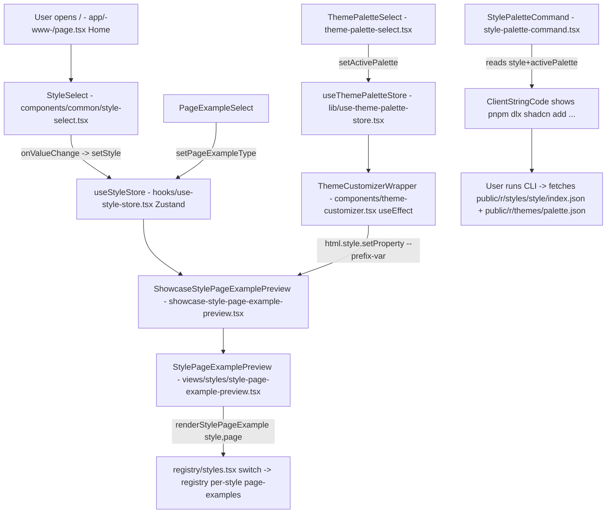
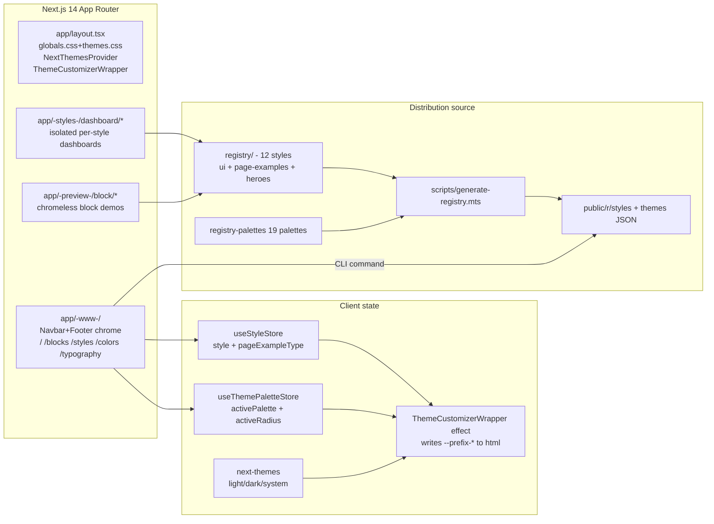
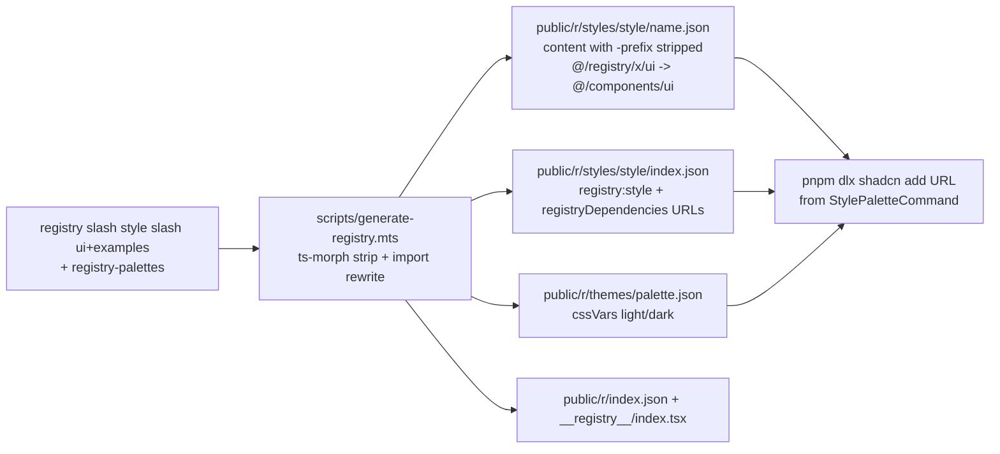
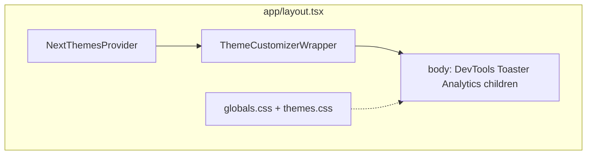
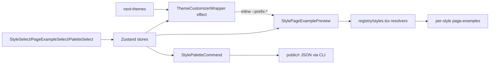

# Shadcn Marketplace — Project Understanding

> Generated 2026-10-12 by senior-engineer onboarding investigation.
> Source of truth: repository source code at `/home/abdelmuttalib/dev/shadcnui-marketplace`.
> Website `https://www.shadcnmarketplace.com/` used only for product context.
> No application code was modified. `npx tsc --noEmit` passes (exit 0).

---

## 1. Executive summary

**Shadcn Marketplace is a static-first marketing + distribution site for alternative shadcn/ui visual styles.** It is not a conventional store with cart/checkout/payments. There is no `app/api/*`, no DB schema, no server actions, no active auth.

What it actually does:

- Showcases **12 full shadcn/ui style kits** (`default`, `carbon`, `catalyst`, `linear`, `material`, `spectrum`, `wedges`, `moon`, `lucid`, `snow`, `neon`, `libelle`) — each a complete fork of ~48 ui primitives + page examples under `registry/<style>/`.
- Lets visitors **switch style → switch page-example (mail/dashboard/cards/tasks/…) → switch color palette (palette-1…19) → switch light/dark** and see a live same-process preview on the homepage (`app/(www)/page.tsx`).
- Distributes styles/palettes through the **official `shadcn` CLI registry protocol**: `pnpm dlx shadcn add "<site>/r/styles/<style>/index.json"` and `.../r/themes/<palette>.json`. JSON is pre-generated at build time by `scripts/generate-registry.mts` into `public/r/`.
- Showcases **copy-paste marketing blocks** (hero/pricing/features/blog/footer/portfolio/landing-page) under `app/(www)/blocks` and `app/(preview)/block/*`, with source display but metadata-only gating (`free|basic|pro` is display data, not enforced).
- Has one real backend endpoint: `pages/api/subscribe.ts` — newsletter `waitlist` insert via Supabase. Auth UI (`components/login-page.tsx`, `components/common/user-menu.tsx`, `app/(www)/account/*`) is scaffolded but commented out / hardcoded demo.

Stack: **Next.js 14.2.5 (App Router) + React 18 + TypeScript + Tailwind 3.4 + Radix primitives + CVA + next-themes + Zustand + Jotai**, deployed wherever Next.js runs (Vercel Analytics enabled). Dark mode via `class`, colors via **OKLCH CSS variables namespaced per style** (`--cb-primary`, `--dft-primary`, …).

---

## 2. Product purpose and target users

| Item | Detail |
|---|---|
| Primary purpose | Sell/distribute drop-in visual replacements for default shadcn/ui styling ("shadcn, your way"). FAQ in `config/site-config.tsx` promises premium style variations, dark-mode support, docs, updates, 14-day refunds — but **no purchase flow exists in code**. |
| Target users | (a) Developers already using shadcn/ui who want a different look without rewriting components; (b) evaluators browsing previews; (c) consumers of free copy-paste blocks. |
| Problems solved | Default/New-York shadcn looks samey; theming from scratch is expensive; blocks speed up landing/marketing pages. |
| Core features | Style gallery, live style×example×palette×mode preview, CLI install command, palette/radius customization + CSS export, blocks gallery, per-style detail pages, colors/typography reference pages. |
| Secondary features | Waitlist subscribe, isolated dashboard demos per style (`/dashboard/<style>`), external full-app demos via iframes (`https://shadcn-<style>.vercel.app`), sitemap/robots/OG metadata, static account/billing mock. |
| Non-features (verified absent) | Cart, checkout, Stripe/Paddle, licenses enforcement, user accounts/sessions, CMS, search backend, comments/reviews, API for styles. `payment\|checkout\|stripe` hits are mock strings in `components/demo/*` and `components/showcase.tsx`. |

---

## 3. Core features and user journeys

### 3.1 Primary journey — "try a style and install it" (homepage `/`)

This is the most important flow and it is fully client-side except for the pre-generated JSON download.



Step-by-step with symbols:

1. `Home()` renders hero (`StyleHeroUI`, `StyleSelect`, `StyleGradientBackgroundColorComponent`) + `shadcn, your way` section (Style/PageExample/Palette selects + `StylePaletteCommand` + `ShowcaseStylePageExamplePreview`) + `StylesPreview` grid.
2. `StyleSelect`: Radix `Select`, `defaultValue={style}`, `onValueChange={e => setStyle(e)}` over `stylesDataList` (from `STYLES_DATA`). No URL change, no persistence (Zustand without persist).
3. `PageExampleSelect` / `ThemePaletteSelect`: same pattern; palette swatches render `oklch(palette[resolvedTheme][key])` for `mainPaletteColorsKeys = [primary, secondary, background, card, accent]`.
4. `ShowcaseStylePageExamplePreview` reads `{style, pageExampleType}` and renders `StylePageExamplePreview` with `key={style}` (forces remount on style change) + a blurred `oklch(var(--<prefix>-primary))` glow div.
5. `StylePageExamplePreview({styleProp, pageExampleTypeProp})` applies `getStyleFontClassname(styleProp)` + `getStyleBackgroundClassname(styleProp)` (e.g. `font-carbon bg-cb-background`) and calls `renderStylePageExample(styleProp, pageExampleTypeProp || pageExampleType)` — a large if/else switch in `registry/styles.tsx` returning e.g. `<CarbonMailPage/>`, `<DefaultCardsPage/>`.
6. Palette/mode effect: `ThemeCustomizerWrapper` (mounted once in `app/layout.tsx` **outside `<body>`**, wrapping it) has `useEffect[theme, style, activePalette, activeRadius, resolvedTheme]`: clears all inline `--*` on `<html>`, then writes `--<prefix>-<var>` for every key in `themePalettes[activePalette][light|dark]` + `--<prefix>-radius`. System theme resolves via `next-themes` `resolvedTheme`. Because each style uses its own CSS-variable namespace, switching style changes which prefixed variables components read — **no class swap needed for style, only for light/dark**.
7. `StylePaletteCommand` composes `pnpm dlx shadcn add "<registryUrl>/r/styles/<style>/index.json" --overwrite [&& pnpm dlx shadcn add "<registryUrl>/r/themes/<palette>.json"]` where `getRegistryUrl()` returns `BASE_SITE_URL (https://shadcnmarketplace.com)` in production else `http://localhost:3000`. Rendered via `ClientStringCode` (shiki-highlighted, copy button).
8. Failure modes: no error boundaries on this path except generic `ComponentWrapper/ErrorBoundary` in some previews; invalid style falls back to `Default*` in `renderStylePageExample`; empty `activePalette` (`DEFAULT_THEME_PALETTE = ""`) means step 6 writes nothing and static `globals.css` tokens apply; CLI 404 if `public/r` wasn't generated (build script `pnpm generate:registry-prod` runs before `next build`).

### 3.2 Style detail — `/styles`, `/styles/<style>`

- `/styles` (`app/(www)/styles/page.tsx`): `PageHeader badge=STYLES_LENGTH` + `StylesPreviewCards`, `StylesPagesExamplesPreviews`, `StylesExamples`.
- `/styles/carbon|moon|neon|wedges` (only 4 have dedicated `page.tsx`): `PageHeader + StylePageExamples style="<name>"` + helpers `style-page-examples.tsx`, `suggested-styles.tsx`, `style-preview.tsx` (iframe to `getStylesPath2(style)/example/<page>`), `examples-nav.tsx`, `styles-preview-cards.tsx`. Other 8 styles have no dedicated page — they render only via homepage selectors and `/dashboard/*`. This is an intentional-or-incomplete gap (see §19).

### 3.3 Blocks — `/blocks`, `/blocks/[slug]`, `/block/*`

- `/blocks` (`app/(www)/blocks/page.tsx`, client): searches `blocksRegistry` keys, renders `BlockCategoryPreviewCardLink` + `BlocksByCategories` + breadcrumb.
- `/blocks/[slug]`: `generateMetadata`, validates `blockCategories.includes(slug)`, maps `blocksRegistry[slug]` to `<BlockPreview><StringCode/></BlockPreview>` + `SuggestedBlocks`. `BlocksNotFound` fallback.
- `/block/<category>/<id>` (`app/(preview)/*`, no www chrome): full-page demos importing `@/registry/wedges/ui/*` directly. `code/examples/*` holds display source. `ComponentPreview` (`component-preview-b.tsx`) adds `StyleSelect` + Pro-gate label (visual only).
- Plans (`free|basic|pro` in `scripts/generate-registry.mts:initialExamplesRegistry` → `config/blocks-registry.ts`) are **metadata, never checked**.

### 3.4 Colors / Typography

- `/colors` (`app/(www)/colors/page.tsx`): `StylesColorsNav + StylesColors` (`style-colors.tsx`, `styles-colors-nav.tsx`, `color-picker.tsx` using `react-colorful`).
- `/typography` (`app/(www)/typography/page.tsx`): `typographyVariantsList[70]`, Tabs preview/code, docs table, `CopyButton` (`copy(code.trim())`).

### 3.5 Waitlist subscribe (only real mutation)

`User action -> WaitlistDialog/form POST /api/subscribe {email} -> pages/api/subscribe.ts validates regex -> supabase.from("waitlist").insert -> 200 | 400 invalid | 500 (duplicate-key message special-cased) | 405 non-POST`. Uses Pages Router (`NextApiRequest/Response`), not App Router.

### 3.6 Account (mock)

`app/(www)/account/page.tsx` renders hardcoded `Jane Doe / Pro Plan $9.99` cards. `user-card.tsx` / `user-menu.tsx` active exports are stubs (`return <div>UserCard</div>`); real Supabase logic is commented out.

---

## 4. Actual technology stack

| Technology | Version / location | Used for | Central? |
|---|---|---|---|
| Next.js App Router | `14.2.5` (`package.json`, `app/layout.tsx`, `app/(www)`, `app/(styles)`, `app/(preview)`) | Routing, SSR/RSC, metadata/sitemap/robots | **Central** |
| React | `^18.3.1` | All UI; `"use client"` for interactive islands, RSC for `StringCode` | Central |
| TypeScript | `^5`, `strict:true`, `@/* -> ./*`, `jsx:preserve` | Type safety; `tsc --noEmit` clean | Central |
| Tailwind CSS | `^3.4.1`, `tailwind.config.ts` (875 lines), `postcss.config.mjs` | Styling; namespaced color system + per-style radius + fonts | Central |
| tailwindcss-animate | `^1.0.7` | Accordion animations | Limited |
| shadcn/ui pattern + Radix | `components.json {style:default, rsc:false, baseColor:gray}`, ~30 `@radix-ui/*`, `cva`, `clsx`+`tailwind-merge` (`lib/utils.ts:cn`, `utils/cn.ts`) | Accessible primitives; every `registry/<style>/ui/*.tsx` follows `buttonVariants = cva(...)` pattern | Central |
| shadcn CLI registry protocol | `shadcn@2.4.0-canary.20`, `scripts/generate-registry.mts`, `public/r/` | Distribution (`registry:ui|style|theme|block|...` JSON) | Central |
| next-themes | `^0.2.1` (`components/next-themes-provider.tsx`: `attribute="class"`, `themes=[light,dark]`, `enableSystem`) | Light/dark | Central |
| Zustand | `^5.0.3` (`hooks/use-style-store.tsx:useStyleStore`, `lib/use-theme-palette-store.tsx`) | Style/example + palette/radius global UI state (no persist) | Central |
| Jotai | `^2.9.2` (`hooks/use-config.ts:configAtom atomWithStorage`, `hooks/use-theme-color.ts`, per-example `use-mail.ts`) | Legacy config + per-demo local state | Limited/legacy |
| Supabase JS | `^2.45.4` (only `pages/api/subscribe.ts`); `@supabase/ssr ^0.5.2` installed **never imported** | Waitlist insert only | Marginal |
| Vercel Analytics | `^1.3.1` (`app/layout.tsx:<Analytics/>`) | Page analytics | Marginal |
| TanStack Table | `^8.9.1` (`components/ui/data-table.tsx`, `registry/*/example/tasks/*`) | Presentational demo tables | Demo-only |
| TanStack Query | `^4.28.0` in deps, **0 imports** | Unused | Dead dep |
| react-hook-form + zod + @hookform/resolvers | deps | Demo forms | Demo-only |
| shiki + hast-util-to-jsx-runtime | (`lib/highlight-code.tsx:codeToHast tsx/dark-plus`) | Code highlighting for `ClientStringCode`/`StringCode` | Supporting |
| copy-to-clipboard, cmdk, sonner, vaul, embla, recharts, date-fns, lucide | deps | Copy buttons, command palette, toasts, carousels, charts | Supporting |
| next-sitemap | (`next-sitemap.config.js`, `postbuild`) + `app/sitemap.ts`, `app/robots.ts` | SEO | Supporting |
| ts-morph, tsx, rimraf | devDeps + scripts | Registry generation | Build-only |
| pnpm workspaces | `pnpm-lock.yaml`, `pnpm-workspace.yaml` | Package management | Tooling |
| nextjs-progressbar, react-beautiful-dnd, react-resizable-panels, input-otp, etc. | deps | Demo page-examples | Demo-only |

Explicitly **not** used (verified): Prisma/Drizzle, any App-Router API routes, Server Actions (`"use server"` appears once, commented), Supabase Auth (commented), Stripe/payments, CMS, i18n, PWA.

---

## 5. High-level architecture



Key insight: **the site and the product are the same codebase.** `registry/<style>/` is simultaneously (a) imported directly for live preview, and (b) serialized to `public/r/*.json` for CLI consumers. `app/` is the showroom; `registry/` is the warehouse; `public/r/` is the loading dock.

---

## 6. Directory and file structure

```
app/
  layout.tsx            # root: css + providers + metadata
  globals.css           # ~1900 lines: :root + per-style --<prefix>-* OKLCH tokens
  themes.css / themes-old.css / catalyst-old.css / simple.css
  not-found.tsx / sitemap.ts / robots.ts
  (www)/               # public site chrome (Navbar/Footer) + /, /blocks, /styles, /colors, /typography, /account, /error
  (styles)/dashboard/<style>/  # isolated full dashboards per style
  (preview)/block/<category>/<id>/  # chromeless block demos
  (internal)/sink/ / (test)/test/   # internal showcase + experiments
registry/
  <style>/ (default carbon catalyst linear material spectrum wedges moon lucid snow neon libelle)
    ui/                 # ~48 primitives per style (button, dialog, select, ...)
    page-examples / examples / example/  # mail/dashboard/cards/tasks/... full pages
    *-hero.tsx / *-showcase-components.tsx / *-card-showcase.tsx
  index.ts / registry-core.ts / registry-ui.ts / registry-lib.ts / registry-hooks.ts
  registry-styles.ts    # 12 styles + defaultRadius
  registry-palettes.tsx # 19 palettes × light/dark × ~30 vars (3596 lines)
  styles.tsx            # resolver switches (prefix/bg/font/render*Page/Hero)
  registry-categories.ts / registry-blocks.tsx / registry-examples.ts / ...
components/
  common/               # style-select, page-example-select, theme-palette-select, style-preview-card, string-code, theme-css-generator, ...
  views/home|styles/    # StylesPreview, StylePageExamplePreview
  ui/                   # default-site chrome primitives (separate from registry forks)
  layout/navbar|footer  # www chrome
  theme-customizer.tsx  # html-variable writer; theme-customizer-tabs, ui-customizer, theme-select/button
  style-palette-command.tsx / style-font-wrapper.tsx / component-preview-b.tsx / ...
config/  site-config.tsx (BASE_SITE_URL, nav, FAQ) / blocks-registry.ts (generated-ish) / index.ts / types.ts
hooks/   use-style-store.tsx (STYLES_DATA, PROD_STYLES_PATH) / use-config.ts / use-theme-color.ts / use-load-component.tsx / ...
lib/     fonts.ts (next/font vars) / utils.ts+utils/cn.ts (cn) / use-theme-palette-store.tsx / registry.ts (runtime accessor) / highlight-code.tsx / copy.ts / ...
utils/   cn.ts / theme-colors.ts / color.js / date.ts
scripts/ generate-registry.mts (active) / build-registry.mts (legacy) / capture/fix-import
code/examples/  display source for blocks
public/r/  index.json + styles/<style>/*.json + styles/<style>/index.json + themes/<palette>.json
pages/api/subscribe.ts  # sole backend endpoint (Pages Router)
components.json / tailwind.config.ts / next.config.mjs / tsconfig.json / next-sitemap.config.js
__registry__/index.tsx  # autogenerated lazy map (stale relative to scripts)
registry.json  # stale minimal demo (do not trust)
docs/project-audit/  # in-progress audit notes (working tree dirty, see §20)
```

Counts: `tailwind.config.ts` 875 lines (11 namespaced palettes + base); `registry-palettes.tsx` 3596 lines; `app/globals.css` ~1900 lines.

---

## 7. Important files and their responsibilities

| File | Responsibility | Caution |
|---|---|---|
| `app/layout.tsx` | Root composition: css imports, `NextThemesProvider > ThemeCustomizerWrapper + body(DevTools, Toaster, Analytics, children)`, SEO metadata | High impact; wrapper sits outside `<body>` |
| `app/globals.css` | Static design tokens: `:root` + `--<prefix>-*` for all styles, gray scale, radius | High impact; editing shifts every preview |
| `tailwind.config.ts` | Maps `oklch(var(--<prefix>-*))` to `bg-<prefix>-*` etc., per-style radius, fonts | High impact |
| `hooks/use-style-store.tsx` | `STYLES`, `STYLES_DATA` (prefix/radius/hero/showcase per style), `useStyleStore{style,setStyle,pageExampleType,setPageExampleType}`, `PROD_STYLES_PATH`, `getStylesPath2` | High impact |
| `lib/use-theme-palette-store.tsx` | `useThemePaletteStore{activePalette,setActivePalette,activeRadius,setActiveRadius,onReset*}` | High impact |
| `registry/styles.tsx` | `getStyleVariablesPrefix`, `getStyleBackground/Foreground/FontClassname`, `renderStylePageExample/Hero/ShowcaseComponents/CardShowcase` | High impact; giant switch must stay in sync when adding styles |
| `registry/registry-styles.ts` | Canonical 12-style list + `defaultRadius` consumed by generator | High impact |
| `registry/registry-palettes.tsx` | 19 palettes, `DEFAULT_THEME_PALETTE=""`, `DEFAULT_RADIUS=""`, key types | High impact |
| `components/theme-customizer.tsx` | `ThemeCustomizerWrapper` effect writing inline vars to `<html>` | High impact |
| `scripts/generate-registry.mts` | `buildRegistry` (`__registry__/index.tsx` + `public/r/index.json`), `buildStyles` (per-component JSON with import rewrite), `buildStylesIndex` (style index), `buildThemes` (palette JSON) | Build-critical |
| `config/site-config.tsx` | `BASE_SITE_URL`, nav, FAQ | Medium |
| `lib/fonts.ts` | `next/font/google` vars (`--font-inter/carbon/roboto/spectrum/poppins/outfit/...`) → `fontVariables` | Medium |
| `lib/registry.ts` | Runtime `getRegistryComponent/Item`, `fixImport`, ts-morph file-tree (mostly used by legacy/dynamic loaders) | Medium |
| `components/style-palette-command.tsx` | CLI command composer | Medium |
| `pages/api/subscribe.ts` | Waitlist endpoint | Low but only backend |
| `components.json` | shadcn config (`style:default`, `rsc:false`, `baseColor:gray`) — note `css` points to non-existent `src/styles/globals.css` (stale) | Stale; don't trust path |

---

## 8. Application initialization and routing

1. `app/layout.tsx:RootLayout` — imports `./globals.css` + `./themes.css`; wraps `<html lang="en">` in `NextThemesProvider` (`attribute="class"`, `themes=[light,dark]`, `enableSystem`); mounts `<ThemeCustomizerWrapper/>` (no children — pure effect), then `<body class="${fontVariables} font-sans antialiased">` with `DevTools`, `Toaster`, `Analytics`, `{children}`.
2. Route groups (parentheses stripped from URL): `(www)` adds `Navbar/main/Footer` (`app/(www)/layout.tsx`); `(styles)` renders own `<html><body>` without providers for isolation (`app/(styles)/layout.tsx`); `(preview)` chromeless block pages; `(internal)/sink` + `(test)/test` internal. No `middleware.ts`, no `loading/error` boundaries (only `app/not-found.tsx` + `app/(www)/error/page.tsx` as a plain route).
3. Metadata: root `metadataBase https://shadcnmarketplace.com` + OG image; `(www)/layout.tsx` duplicates metadata with alternate domain `https://shadcn-ui-marketplace.com` (inconsistency, §19). `sitemap.ts` enumerates `/`, `/blocks`, `/blocks/<slug>`; `robots.ts` allows `/ /blocks /styles /typography`.
4. Fonts: `lib/fonts.ts` loads Inter, IBM Plex Mono/Sans (`--font-carbon`), Roboto (`--font-roboto`), Ubuntu (`--font-spectrum`), Poppins, Outfit; `fontVariables` injected in every layout's `<body>`/`className`.
5. `DevTools` (`components/dev-tools.tsx`) renders only when `NODE_ENV development`-ish; `Toaster` (sonner) for copy toasts.

---

## 9. Design system and theming architecture

Three layers:

1. **Static tokens** — `app/globals.css` `:root{--background … --radius, --cb-*, --dft-*, --material-*, …}` all in **OKLCH** (e.g. `--cb-primary:55.65% 0.24 261.95`). `themes.css` adds `.theme-*-palette*` overrides.
2. **Tailwind mapping** — `tailwind.config.ts` exposes `colors.{dft,cb,catalyst,linear,material,spctm,wedges,moon,lucid,snow,neon,libelle,gray,background…}` as `oklch(var(--<prefix>-<token>) / <alpha-value>)`, `borderRadius` per prefix (`--cb-radius`, `--dft-radius`, …), `fontFamily` per `var(--font-*)`. `darkMode: ["class"]`.
3. **Runtime override** — `ThemeCustomizerWrapper` clears inline `--*` on `<html>` then sets `--<prefix>-<key> = themePalettes[activePalette][mode][key]` + radius. Because components reference `bg-<prefix>-primary` → `var(--<prefix>-primary)`, palette changes propagate without re-render; style changes switch which prefix components use.

Mode handling: `next-themes` toggles `.dark` on `<html>`; palette writer respects `theme === "system" ? resolvedTheme : theme`. Default `activePalette = ""` and `activeRadius = ""` mean **no override until user picks** — static CSS wins initially. `ThemePaletteReset` restores `""`.

Per-style fonts: `getStyleFontClassname` maps carbon→`font-carbon`, material→`font-material`, spectrum→`font-spectrum`, neon→`font-poppins`, libelle→`font-outfit`, rest→`font-sans`.

---

## 10. shadcn/ui integration

- `components.json`: standard shadcn shape but `rsc:false` (client-first), `css: src/styles/globals.css` is **stale** (real file is `app/globals.css`).
- `registry/registry-ui.ts` declares 48 items (`accordion…typography`, `{name, type:registry:ui, dependencies, registryDependencies, files:[{path:ui/*.tsx}]}`) mirroring upstream shadcn.
- Each `registry/<style>/ui/*.tsx` is a **full fork**, not a skin: e.g. `registry/default/ui/button.tsx` (`buttonVariants = cva("…bg-dft-primary…rounded-dft-md…")`), `registry/carbon/ui/button.tsx` uses `bg-cb-*`. Same API, different tokens/classes.
- Shared `cn()` (`lib/utils.ts`, `utils/cn.ts`), `cva` variants, Radix Slot/primitives preserve accessibility.
- The site's own chrome uses `components/ui/*` (default tokens), while previews import `registry/<style>/*` — two parallel implementations of the same components coexist, which is why style switching never leaks into Navbar/Footer.

---

## 11. Component preview and customization flow

Two mechanisms:

**A. Same-process direct render (homepage + style pages)** — `renderStylePageExample` / `renderStyleHero` / `renderStyleShowcaseComponents` switch statements in `registry/styles.tsx`; wrappers `StylePageExamplePreview`, `StyleHeroUI`, `StylePreviewCard`, `ComponentWrapper/ErrorBoundary`, `StyleFontWrapper/StyleCssWrapper`. No iframe, no style conflict because namespaces (`bg-cb-*` vs `bg-dft-*`) are disjoint. `key={style}` remounts on switch.

**B. Isolated iframe (style detail + dashboard links)** — `StylePreview` / `views/styles/style-preview.tsx` render `<iframe src={getStylesPath2(style)/example/<page>}>` pointing at **external Vercel deployments** (`PROD_STYLES_PATH`: `https://shadcn-<style>.vercel.app`). Breakpoint buttons (`sm|md|lg`) resize the frame. Note `getStylesPath2`/`getStyles` currently return `PROD_*` regardless of env (dead `NODE_ENV` branch — likely leftover).

**Customization inputs:** `StyleSelect` (style) → Zustand; `PageExampleSelect` (example) → Zustand; `ThemePaletteSelect` + `ThemePaletteReset` (palette) → Zustand; `ThemeModeSelect/Radio`, `ThemeSwitcher` (`components/theme-select.tsx`) → next-themes; radius via `ThemeCustomizerTabs`/`UICustomizer`. Outputs: live preview (A), iframe (B), `ThemeCSSGenerator` (`generateCSS()` → `:root{--key:value}+.dark{…}+--radius` + copy button), `ThemeCustomizerTabs` Export JSON/CSS buttons (config-code generator is a stub), `StylePaletteCommand` CLI string.

Switching styles does **not** reset palette/radius (stores are independent) — a palette picked for carbon applies its raw values under the new style's prefix, which can look surprising. This is current behavior, not a bug fix request.

---

## 12. State management and data flow

- **Zustand (primary):** `useStyleStore{style /* default STYLES[7] = "moon" */, setStyle, pageExampleType /* default "cards" */, setPageExampleType}`; `useThemePaletteStore{activePalette /* "" */, activeRadius /* "" */, setters, onReset*}`. No persist, no URL sync — refresh resets to moon/cards/no-palette.
- **Jotai (legacy/secondary):** `configAtom atomWithStorage("config", {style:"default", theme:"zinc", radius:0.5})` (`hooks/use-config.ts`), `themeColorAtom` (`hooks/use-theme-color.ts`) — `zinc` theme names belong to upstream shadcn and are **unused by the style system**; per-demo `use-mail.ts` atoms are local.
- **next-themes:** `theme/resolvedTheme/setTheme` for light/dark/system.
- **No server state:** TanStack Query installed but unused; no fetch/SWR; TanStack Table is presentational over hardcoded `payments/invoices` in `components/demo/*`.
- Derived state: glow color `oklch(var(--<prefix>-primary))`, palette swatches `oklch(palette[mode][key])`, CLI string, generated CSS — all computed during render, no memoization issues at this scale.

---

## 13. Backend and external integrations

| Integration | Evidence | Status |
|---|---|---|
| Supabase waitlist | `pages/api/subscribe.ts:createClient(...).from("waitlist").insert` | **Live** (sole mutation) |
| Supabase Auth | `components/login-page.tsx:login/signup/signInWithGitHub` (all commented), `user-menu.tsx`, `user-card.tsx` | Disabled scaffold |
| Vercel Analytics | `app/layout.tsx:<Analytics/>` | Live |
| Unsplash images | `next.config.mjs:images.domains=[images.unsplash.com]` | Config only |
| External style deployments | `PROD_STYLES_PATH` 12× `https://shadcn-<style>.vercel.app` | Referenced by iframes; availability unverified |
| Sitemap | `next-sitemap` postbuild + `app/sitemap.ts` | Build-time |
| Env vars (names only) | `NEXT_PUBLIC_SUPABASE_URL`, `NEXT_PUBLIC_SUPABASE_ANON_KEY`, `NEXT_PUBLIC_APP_URL`, `NEXT_PUBLIC_NODE_ENV`, `NODE_ENV` | No secrets exposed |

Frontend↔backend communication is limited to `POST /api/subscribe`. Everything else is static render + client state + CLI download of static JSON.

---

## 14. Component export / distribution workflow



Details:

- Trigger: `pnpm generate:registry-prod` (runs as `prebuild` via `build` script) or `:local` for dev. Validates with `registrySchema`/`registryItemSchema` (from `shadcn/registry`) + zod.
- `buildStyles`: reads `registry/<style>/<file.path>`, strips `iframeHeight/containerClassName/description` vars, rewrites `/-(dft|cb|catalyst|…)\b/g → ""` and `@/registry/<style>/ui → @/components/ui` so output is portable, writes per-component JSON.
- `buildStylesIndex`: writes `registry:style` index with `registryDependencies: [utils, ...<absolute URLs to each component JSON>]` using `BASE_SITE_URL` (prod) or localhost (dev).
- `buildThemes`: writes one JSON per palette (`registry:theme`, `cssVars{light,dark}`).
- Consumer: pastes `StylePaletteCommand` output; `shadcn add` fetches JSON and installs files. Copy path: `lib/copy.ts:onCopy` / `CopyButton` / `ThemeCSSGenerator onCopy` + `sonner` toast; highlight via `lib/highlight-code.tsx` (shiki `dark-plus`).
- Errors: generator `process.exit(1)` on invalid categories/schema; runtime copy failures surface as no-op (no catch in `onCopy`); stale `__registry__/index.tsx` / `registry.json` are **not** consumed by this flow — do not treat them as live.

---

## 15. Important execution paths

### P1. Homepage style switch (traced, §3.1)
`Select.onValueChange → useStyleStore.setStyle → ShowcaseStylePageExamplePreview re-render (key remount) → renderStylePageExample → per-style page component`. Palette effect runs independently via `ThemeCustomizerWrapper`.

### P2. Palette + mode apply (traced)
`ThemePaletteSelect.onValueChange → setActivePalette → ThemeCustomizerWrapper.useEffect → html.style.setProperty(--<prefix>-<k>, v) (+radius) → CSS var cascade repaints preview`. `ThemeModeSelect → next-themes setTheme → .dark class + resolvedTheme → effect re-runs picking other palette side`.

### P3. Install (traced)
`StylePaletteCommand reads stores → ClientStringCode renders command → user copies (CopyButton → copy-to-clipboard → toast) → runs in terminal → shadcn CLI GETs public/r JSON → files written to consumer project`.

### P4. Blocks browse (verified by reading pages)
`/blocks client filter over blocksRegistry → Link localHref /block/<cat>/<id> → (preview) page renders wedges-based demo + StringCode source → copy`.

### P5. Subscribe (verified)
`form → fetch POST /api/subscribe → regex check → supabase insert waitlist → 200/400/500/405 JSON`.

---

## 16. Feature dependencies

- Changing `app/globals.css` tokens or `tailwind.config.ts` mappings affects **every** preview, dashboard, block, and generated-site appearance (highest blast radius).
- Changing `registry/styles.tsx` resolvers or `hooks/use-style-store.tsx:STYLES_DATA` affects homepage, style pages, showcase, and iframe URL helpers.
- Changing `registry/registry-palettes.tsx` affects palette selects, `ThemeCustomizerWrapper`, CSS generator, theme JSON output, and all `public/r/themes/*`.
- Changing one `registry/<style>/ui/*` affects only that style's previews + its generated JSON (isolated by prefix).
- Changing `config/site-config.tsx:BASE_SITE_URL` changes CLI commands and generated `registryDependencies` URLs.
- Changing `lib/fonts.ts` affects all layouts (font vars) and per-style font mapping.
- `components/ui/*` (site chrome) is independent of `registry/*/ui/*` (product) — editing one does not affect the other, except shared `cn()`.

---

## 17. Testing and build setup

| Command | `package.json` | Result in this investigation |
|---|---|---|
| `pnpm dev` / `tdev` | `next dev [--turbo]` | Not run (investigation-only, no installs) |
| `pnpm build` | `pnpm generate:registry-prod && next build` | Not run (would write `public/r`, `__registry__`) |
| `pnpm lint` | `next lint` | Not run |
| `npx tsc --noEmit` | (tsc directly) | **Ran 2026-10-12: clean, exit 0** |
| `generate:registry-local/prod` | `tsx … generate-registry.mts --env=*` | Not run (writes files) |
| Unit tests | None configured (no vitest/jest/playwright in deps or scripts) | Absent — no test suite to run |
| `postbuild` | `next-sitemap` | Not run |

ESLint (`eslint-config-next`), Prettier + `prettier-plugin-tailwindcss`, `eslint-plugin-simple-import-sort` configured but not executed here.

---

## 18. Existing conventions that developers should preserve

1. **Per-style CSS-variable namespaces** (`dft|cb|catalyst|linear|material|spctm|wedges|moon|lucid|snow|neon|libelle`) end-to-end: `globals.css` → `tailwind.config` → `getStyleVariablesPrefix` → component classes (`bg-<prefix>-primary`, `rounded-<prefix>-md`). Never hardcode a bare `bg-primary` inside `registry/<style>/`.
2. **Fork, don't share, style implementations**: each style owns its `ui/` copy; cross-style imports (`@/registry/carbon/…` from wedges) are forbidden except via `registry/styles.tsx` resolvers.
3. **Resolver switches stay exhaustive**: adding a style means touching `registry-styles.ts`, `use-style-store.tsx` (`STYLES_DATA`, `PROD_STYLES_PATH`, `DEV_STYLES_PATH`), `registry/styles.tsx` (all `render*/get*` functions), `tailwind.config.ts`, `globals.css`, generator regex.
4. **OKLCH everywhere** for theme colors; `hexToOklch` helpers in `lib/color.js` / `utils/color.js` for conversion.
5. **Client islands**: interactive files start `"use client"`; `StringCode` stays RSC, `ClientStringCode` client (shiki needs effect).
6. **`cn()` for every conditional class**; `cva` for variants; Radix for behavior + a11y.
7. **Registry JSON is generated** — never hand-edit `public/r/*` or `__registry__/index.tsx`; edit `registry/` + palettes and re-run the generator.
8. **Import rewrite rule**: registry sources may reference `@/registry/<style>/ui`; generated output rewrites to `@/components/ui` — keep that pattern so output stays portable.

---

## 19. Potential technical debt and known limitations

1. **No commerce despite marketplace copy/FAQ** (pricing, refunds, multi-project licenses in `site-config.tsx` FAQ): anyone implementing checkout must build it from zero.
2. **Auth dead scaffold**: `login-page.tsx`, `user-menu.tsx`, `user-card.tsx` commented out; `@supabase/ssr` unused; no callback route. `account` page is hardcoded demo.
3. **Only 4 of 12 styles have `/styles/<style>` detail pages** (carbon/moon/neon/wedges). Others are reachable via `/`, `/dashboard/*`, iframes only.
4. **`getStylesPath2`/`getStyles` ignore env** (both branches return `PROD_STYLES_PATH`) — dev iframe still hits production Vercels.
5. **Default store is `STYLES[7]` ("moon")** with `pageExampleType "cards"` and empty palette — surprising default; homepage never shows `default` style first.
6. **Stale files**: root `registry.json` (demo only), `__registry__/index.tsx` (regenerated on build, currently stale), `components.json:css → src/styles/globals.css` (path doesn't exist), `themes-old.css/catalyst-old.css/simple.css`, `registry-themes.ts` (legacy palette-1…12 duplicate of `registry-palettes.tsx` 1…19), `lib/themes.ts`/`lib/styles.ts` (upstream zinc/slate… unused), `component-preview.tsx` (commented stub), `ThemeCustomizerTabs` config-code stub.
7. **Duplicated `cn`/`color` utils** (`lib/utils.ts` vs `utils/cn.ts`, `lib/color.js` vs `utils/color.js`, `lib/cssVarsToJs.js` vs `utils/css.txt`) — import from either works today but invites drift.
8. **Metadata domain inconsistency**: `app/layout.tsx` uses `shadcnmarketplace.com`, `(www)/layout.tsx` + `sitemap.ts` use `shadcn-ui-marketplace.com`, OG image yet another host. Canonicalize before SEO work.
9. **No tests, no error boundaries on key flows**, copy helpers lack error handling, `blocksRegistry.code` uses async `getCode` without await discipline (logs promise).
10. **Two `body`-level layouts** (`(styles)`, `(test)`) render own `<html>` — easy to break global providers when adding pages there.

---

## 20. Unverified assumptions and unanswered questions

- [ ] **Unverified**: whether `https://shadcn-<style>.vercel.app` deployments are live (iframe path depends on them; network not probed here).
- [ ] **Unverified**: Supabase `waitlist` table shape beyond `{email unique}` and whether env vars exist in deployment (names only inspected; values never read).
- [ ] **Unverified**: who owns/updates the 12 external style deployments and how they stay in sync with this repo.
- [ ] **Unexplored**: full contents of `components/demo/*`, `code/examples/*`, `docs/` marketing copy, `public/` assets, per-style `page-examples` internals (sampled, not exhaustively read — each is hundreds of lines × 12 styles).
- [ ] **Working tree**: `git status` shows `M docs/project-audit/AUDIT_PROGRESS.md`, `M docs/project-audit/README.md`, `?? docs/project-audit/baselines/` — a parallel audit is in flight; coordinate before touching `docs/`.
- [ ] **Assumption (marked)**: product intent is style-kit distribution rather than finished-app sales — inferred from registry generator + FAQ + absence of commerce code, not from stakeholder confirmation.

---

## 21. Glossary of project-specific concepts

| Term | Meaning |
|---|---|
| Style / Style kit | One of 12 named forks (`default…libelle`), each with own CSS-var prefix, radius, font, full `ui/` + page examples. |
| Prefix | Short token namespace per style (`dft`, `cb`, `spctm`, …) via `getStyleVariablesPrefix`. |
| Palette | One of 19 `palette-N` color sets (`registry-palettes.tsx`), each with `light`+`dark` OKLCH maps applied under the active style's prefix. |
| Page example | Full demo app page (`mail|dashboard|cards|tasks|playground|forms|music|authentication[+charts|board]`) rendered per style. |
| Block | Marketing copy-paste section (`hero-sections`, `pricings`, `features`, `blog-sections`, `footers`, `portfolios`, `landing-pages`). |
| Plan (`free\|basic\|pro`) | Display-only block metadata; not enforced. |
| Registry JSON | shadcn-CLI-compatible artifacts under `public/r/` (`styles/<style>/*.json`, `themes/*.json`). |
| `StylePaletteCommand` | Rendered CLI string installing current style + palette. |
| `ThemeCustomizerWrapper` | Mount-once effect writing palette/radius vars onto `<html>`. |
| `(www)/(styles)/(preview)` | Route groups: public chrome / isolated dashboards / chromeless block demos (groups don't affect URLs). |

---

## Appendix A — Development guide (where to change what)

| Task | Location | Notes |
|---|---|---|
| Add a new page | `app/(www)/<name>/page.tsx` (public chrome) or `app/(preview)/…` (chromeless) | Add nav link in `config/site-config.tsx:mainLinks`; add to `app/sitemap.ts` + `robots.ts` if public. |
| Add a reusable site component | `components/common/*` (shared) or `components/ui/*` (chrome primitives) | Never import from `registry/<style>/` into chrome except via resolvers. |
| Modify the design system | `app/globals.css` (tokens) + `tailwind.config.ts` (mappings) | Highest blast radius; verify all 12 prefixes. |
| Add/modify a theme (style) | `registry/registry-styles.ts` + `registry/<style>/` fork + `hooks/use-style-store.tsx:STYLES_DATA` + `registry/styles.tsx` switches + `tailwind.config.ts` + `globals.css` + generator regex in `scripts/generate-registry.mts` | Keep all seven in sync. |
| Add/modify a palette | `registry/registry-palettes.tsx` (`themePalettes`, types) | Regenerate registry to refresh `public/r/themes/*`. |
| Modify preview behavior | Same-process: `components/views/styles/style-page-example-preview.tsx`, `components/common/showcase-*.tsx`; iframe: `components/common/style-preview.tsx`, `app/(www)/styles/components/*` | Preserve `key={style}` remount + namespaced classes. |
| Modify state/data flow | `hooks/use-style-store.tsx`, `lib/use-theme-palette-store.tsx`, `components/theme-customizer.tsx` | Stores are ephemeral; add persist/URL sync deliberately. |
| Integrate new API/backend | Prefer `app/api/*` (App Router) for new endpoints; existing `pages/api/subscribe.ts` is legacy Pages Router | Add env names to this doc; never commit secrets. |
| Modify export/distribution | `scripts/generate-registry.mts` + `components/style-palette-command.tsx` + `components/common/theme-css-generator.tsx` | Run `pnpm generate:registry-local`, diff `public/r`, then build. |
| Shared files requiring caution | `app/globals.css`, `tailwind.config.ts`, `registry/styles.tsx`, `hooks/use-style-store.tsx`, `registry/registry-palettes.tsx`, `components/theme-customizer.tsx`, `config/site-config.tsx` | See §16 blast radius. |
| Validate changes | `npx tsc --noEmit` (clean at baseline) + `pnpm lint` + `pnpm generate:registry-local` + `pnpm build` | No unit-test suite exists; add manual preview checks per style × palette × mode. |

---

## Appendix B — Architecture diagrams




