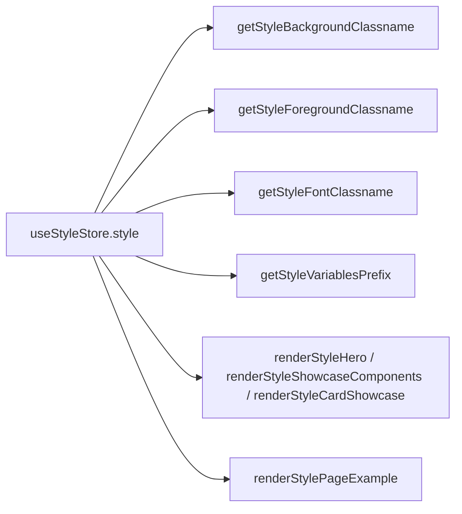

# PROJECT_OVERVIEW — Shadcn Marketplace

Audit date: 2026-10-09. Method: source inspection only (no runtime verification).
All paths repository-relative.

## 1. What the application does

A marketing + distribution site ("marketplace") for 12 shadcn/ui-based visual styles.
Each style ships its own copy of 48 UI primitives, its own design tokens, hero,
showcase components, card showcase, and full page examples (mail, dashboard, cards,
tasks, playground, forms, music, authentication, plus extras). Visitors browse styles
at `/styles/<style>`, preview components/pages, copy code, and install via a generated
`public/r` shadcn registry. (Verified: `registry/styles.tsx`, `hooks/use-style-store.tsx`,
`scripts/generate-registry.mts:20`.)

## 2. Intended audience

Developers choosing/installing a shadcn/ui style kit; style authors adding new styles.
Evidence: registry generation for external `shadcn build` consumption
(`package.json` scripts `registry:build`, `generate:registry-prod`), per-style
Vercel deploy URLs in `hooks/use-style-store.tsx:58-71`.

## 3. Major features

- 12 style kits with independent `ui/` implementations (`registry/<style>/ui/`, 48 files each).
- Style switcher (zustand `useStyleStore`, `hooks/use-style-store.tsx:323-338`).
- Per-style hero (`*-hero.tsx`), showcase (`*-showcase-components.tsx`),
  card showcase (`*-card-showcase.tsx`), page examples (`page-examples.tsx`).
- Style→class/style→font/style→page resolvers in `registry/styles.tsx:163-623`
  (`getStyleBackgroundClassname`, `getStyleForegroundClassname`, `getStyleFontClassname`,
  `getStyleVariablesPrefix`, `renderStylePageExample`, `renderStyleHero`,
  `renderStyleShowcaseComponents`, `renderStyleCardShowcase`).
- Generated shadcn registry (`scripts/generate-registry.mts` → `public/r`),
  built on `next build` via `generate:registry-prod` (`package.json:9`).
- Theme palettes (`.theme-<style>-*` classes, `app/themes.css`, 595 lines) + theme/palette
  stores (`lib/use-theme-palette-store.tsx`, `hooks/use-theme-color.ts`).
- Blocks/examples/templates catalogs (`config/blocks-registry.ts`, `registry/registry-*.ts`).

## 4. Technology stack (actual versions from `package.json`)

| Layer | Version (verified) |
|---|---|
| Next.js | 14.2.5 (App Router; `eslint-config-next` 15.1.6 — mismatch, see debt) |
| React / ReactDOM | 18.3.1 |
| Tailwind CSS | 3.4.1 (+ `tailwindcss-animate` 1.0.7, `@tailwindcss/forms` 0.5.7); **not** Tailwind v4 |
| shadcn CLI | 2.4.0-canary.20 |
| Radix UI | ~20 packages (accordion 1.1.2 … tooltip 1.0.6) |
| cva / clsx / tailwind-merge | 0.7.0 / 2.1.1 / 2.4.0 |
| State | zustand 5.0.3 (style store), jotai 2.9.2, @tanstack/react-query 4.28.0 |
| Forms/data | react-hook-form 7.52.2, zod 3.23.8, @tanstack/react-table 8.9.1, recharts 2.15.1 |
| Misc UI | cmdk 0.2.0, vaul 1.1.2, sonner 0.3.5, embla-carousel 8.5.2, input-otp 1.4.2, next-themes 0.2.1 |
| Backend | @supabase/ssr 0.5.2, @supabase/supabase-js 2.45.4 |
| Registry tooling | ts-morph 26.0.0, tsx 4.20.2, shiki 1.26.1, rimraf 6.0.1 |
| Package manager | pnpm (`pnpm-lock.yaml` present) |

## 5. Overall architecture

```mermaid
flowchart TD
  Store[useStyleStore zustand] --> Resolvers[registry/styles.tsx resolvers]
  Resolvers --> Tokens[bg/fg/font/prefix classes + CSS vars in globals.css]
  Resolvers --> UI[registry/<style>/ui/* 48 primitives]
  Resolvers --> Showcase[*-hero + *-showcase-components + *-card-showcase]
  Resolvers --> Pages[page-examples.tsx per style]
  UI --> Gen[scripts/generate-registry.mts → public/r]
  App[app (styles)/(www)/(preview) routes] --> Store
  App --> Resolvers
  TW[tailwind.config.ts prefix→oklch var map] --> UI
```

- `registry/<style>/` directories are the product; `components/` is site chrome
  (its own `components/ui/*` copy + dev-tools, theme-customizer, etc.).
- `registry/registry-core.ts`, `registry-ui.ts`, `registry-blocks.tsx`,
  `registry-examples.ts`, `registry-themes.ts`, `registry-styles.ts` etc. compose the
  shadcn registry definition consumed by the generation script.
- `lib/component-loader.tsx` dynamically imports `@/registry/<style>/example/<name>-demo`.

## 6. Routing structure

- `app/layout.tsx` (root: loads `globals.css` + `themes.css`, `fontVariables`,
  `ThemeCustomizerWrapper`, site `Toaster`).
- `app/(styles)/layout.tsx` (standalone style layout: `globals.css` font vars only).
- `app/(styles)/dashboard`, `app/(www)/{page,styles/{carbon,moon,neon,wedges,components},blocks,colors,typography,account}`,
  `app/(preview)/block`, `app/(internal)/`, `app/(test)/`.
- Canonical per-style site path: `/styles/<style>` (`getStyleSitePath`, `registry/styles.tsx:123-127`).
- Style subsites also deployed per-style on Vercel (`PROD_STYLES_PATH`, `hooks/use-style-store.tsx:58-71`).

## 7. State management

- `useStyleStore` (zustand): `{ style, pageExampleType }` + setters.
  Default `style: STYLES[7]` where `STYLES = Object.keys(STYLES_PATH)` =
  `[default, carbon, linear, catalyst, material, spectrum, wedges, moon, lucid, snow, neon, libelle]`,
  so the default is **moon** (verified fact; easily misread as lucid if catalyst is forgotten).
- `lib/use-theme-palette-store.tsx`, `hooks/use-config.ts`, `hooks/use-theme-color.ts`,
  `hooks/use-load-component.tsx` for theme/palette/config/demo loading. Details not yet audited.

## 8. Styling architecture

- Tailwind v3, `darkMode: ["class"]` (`tailwind.config.ts:4`), content covers
  `components/`, `app/`, `registry/`.
- `tailwind.config.ts` maps 12 prefixed namespaces (`dft`, `cb`, `linear`, `material`,
  `catalyst`, `spctm`, `wedges`, `moon`, `lucid`, `snow`, `neon`, `libelle`) to
  `oklch(var(--<prefix>-*) / <alpha-value>)`, plus legacy unprefixed tokens and
  `gray` scale; per-prefix radius utilities (`<prefix>-{sm,md,lg}` from
  `--<prefix>-radius`); `fontFamily` entries for sans/mono/carbon/material/spectrum/
  general-sans/public-sans/dm-sans/work-sans/poppins/dm-serif-display/outfit.
- `app/globals.css` (1903 lines): `@tailwind` directives + one large `@layer base`
  with `:root` legacy vars (`--background`, `--color-gray-*`, …), then per-prefix
  token blocks, then `.dark` legacy overrides. Per-prefix dark-mode blocks were
  **not found** in `globals.css` (only `.dark` legacy + `.dark .neon-test`);
  per-palette dark variants live in `app/themes.css` (`.dark .theme-*`) — needs verification
  whether every style has one.
- Components reference tokens via prefixed utilities (e.g. `bg-dft-primary`,
  `rounded-cb-md`). Token value chains (semantic → palette → raw oklch) documented in Stage 4.

## 9. Design system architecture

One foundation × 12 namespaces. Levels of customization (verify per component in Stage 5):

1. **Global**: token values, radius, font class — affect all components of a style.
2. **Component-level**: class/variant/size edits inside `registry/<style>/ui/*.tsx`.
3. **Structural/behavioral**: export/API/DOM changes (e.g. default `Button` exports
   `ButtonLink` with `iconLeft/iconRight`; carbon/neon export only `Button, buttonVariants` —
   verified `registry/default/ui/button.tsx:106` vs `registry/carbon/ui/button.tsx:59`,
   `registry/neon/ui/button.tsx:60`).

## 10. Component architecture

- cva `buttonVariants`-style variant definitions + Radix Slot `asChild` + `cn()` merge
  (`lib/utils.ts:4-6`, `clsx` + `tailwind-merge`).
- Each style owns full copies (not wrappers): all 12 `ui/` dirs contain the same 48 filenames.
- `components/ui/` is a separate site-chrome copy (plus `animated-dialog`, `fullscreen-dialog`,
  `rich-badge` not in registry set — unverified which baseline it tracks).

## 11. Registry organization

`registry/` top level: `index.ts`, `styles.tsx` (runtime resolvers), `registry-core.ts`
(composition), `registry-ui.ts` (48 item defs with deps), `registry-styles.ts` (12 style defs),
`registry-themes.ts`/`themes.ts`, `registry-blocks.tsx`, `registry-examples.ts`,
`registry-categories.ts`, `registry-charts.ts`, `registry-hooks.ts`, `registry-icons.ts`,
`registry-lib.ts`, `registry-internal.ts`, `registry-index.tsx`, `registry-palettes.tsx`.
Per-style dirs: `ui/`, `example/`, `examples/`, `blocks/`, `components/`, `hooks/`, `lib/`,
`internal/`, `charts/` (moon only, spotted), hero/showcase/card-showcase/page-examples/showcase files.

## 12. Font loading system

`lib/fonts.ts`: `next/font/google` — Inter (`--font-inter`), IBM Plex Mono
(`--font-ibm-plex-mono`), IBM Plex Sans (`--font-carbon`), Roboto (`--font-roboto`),
Ubuntu (`--font-spectrum`), Poppins (`--font-poppins`), Outfit (`--font-outfit`);
combined into `fontVariables`, applied on `<body>` in both layouts.
`getStyleFontClassname` (`registry/styles.tsx:225-254`, verified): carbon→`font-carbon`,
material→`font-material`, spectrum→`font-spectrum`, neon→`font-poppins`,
libelle→`font-outfit`; default/linear/catalyst/wedges/moon/lucid/snow→`font-sans` (Inter).
`general-sans/public-sans/dm-sans/work-sans/dm-serif-display` font families exist in
tailwind config with no verified loader — needs investigation (Stage 4).

## 13. Theme and CSS variable system

Prefixes: `dft` (default), `cb` (carbon), `linear`, `material`, `catalyst`, `spctm`
(spectrum — note truncation), `wedges`, `moon`, `lucid`, `snow`, `neon`, `libelle`
(verified `getStyleVariablesPrefix`, `registry/styles.tsx:287-316`).
Each namespace defines semantic → chart → sidebar → radius tokens; several define
primitive palettes (`dft-color-*`, `spctm-color-*`, `material-color-*`, `wedges-*`,
`moon-*` piccolo/jiren/hit/heles/beerus/goku/gohan/zeno/bulma/trunks/goten/popo).
Custom `moon-*` names must be traced by usage, not guessed (Stage 4).

## 14. Style selection mechanism



## 15. Preview and showcase system

Per style: `*-hero.tsx`, `*-showcase-components.tsx`, `*-card-showcase.tsx`, `showcase.tsx`,
dispatched by the `renderStyle*` functions above. Page examples dispatched by
`renderStylePageExample(style, page)`.

## 16. Code-copying / code-generation

`scripts/generate-registry.mts` (793 lines, ts-morph) composes `registry-core` + styles +
themes + categories into `public/r/*.json`; `lib/copy.ts`, `lib/highlight-code.tsx`
(shiki), `lib/registry-script.mjs`, `lib/generate-registry.ts`, `config/block-script.tsx`
support copy/display. `components.json` declares the shadcn client config.

## 17. External integrations

Supabase (ssr + js), Vercel Analytics, `images.domains: ["images.unsplash.com"]`
(`next.config.mjs:15-17`), per-style Vercel deployments, `next-sitemap` postbuild.

## 18. Build and development workflow

`dev: next dev`; `build: pnpm generate:registry-prod && next build` then `postbuild: next-sitemap`;
`generate:registry-local` for dev; `registry:build: shadcn build`; `format: prettier --write .`;
`sort-imports` via eslint. Toolchain: TS 5, eslint 8 + eslint-config-next 15.1.6, prettier 2.8.6,
tsx 4.20.2, tsconfig.scripts.json for scripts.

## 19. Important architectural constraints

- Every style duplicates all 48 primitives: any upstream shadcn change must be ported 12×.
- Token renames break Tailwind-mapped classes silently (no type safety on class strings).
- `ButtonLink` export exists in default, moon, lucid, and libelle button implementations;
  absent in the other 8 styles (recorded as `PARITY_DIVERGENCE`, drift — no in-repo consumer
  imports it; see `components/<style>/button-vs-default.md` §8). Other components unchecked.
- `renderStylePageExample` fallbacks: `charts` → always `MoonChartsPage`;
  `board` → Material/Libelle own impl else `NeonBoardPage` (`registry/styles.tsx:318-333`) —
  shared-vs-accidental status unresolved, must not be "fixed" during audit.

## 20. Known technical debt and upgrade considerations (Stage 1 findings)

1. `components.json:8` points Tailwind CSS at `src/styles/globals.css`, which does not exist
   (actual: `app/globals.css`). Stale config — record, do not fix.
2. `registry.json` (repo root) is a stale minimal sample (hello-world + 4-file carbon style);
   real registry is composed in `registry/*.ts`. Do not treat root `registry.json` as authoritative.
3. Radius mismatches: `registry-styles.ts` says default `0.5rem`/snow `0.4rem`, but
   `globals.css` defines `--dft-radius: 0.4rem` and `--snow-radius: 0.75rem`. Unresolved.
4. `getStylesPath`/`getStylesPath2` always return `PROD_STYLES_PATH` regardless of env;
   `DEV_STYLES_PATH` is dead code (`hooks/use-style-store.tsx:76-88`).
5. `.dark` in `globals.css` only overrides legacy vars; per-style dark coverage depends on
   `themes.css` palettes — completeness unverified.
6. Commented-out legacy `ButtonLink` inside `.dark` block (`globals.css`) — historical evidence, keep.
7. `lib/styles.ts` (default/new-york) contradicts the real 12-style system; likely legacy.
8. Default store value `STYLES[7]` = moon only when catalyst is counted — fragile implicit indexing.
9. `eslint-config-next 15.1.6` vs `next 14.2.5` version skew.
