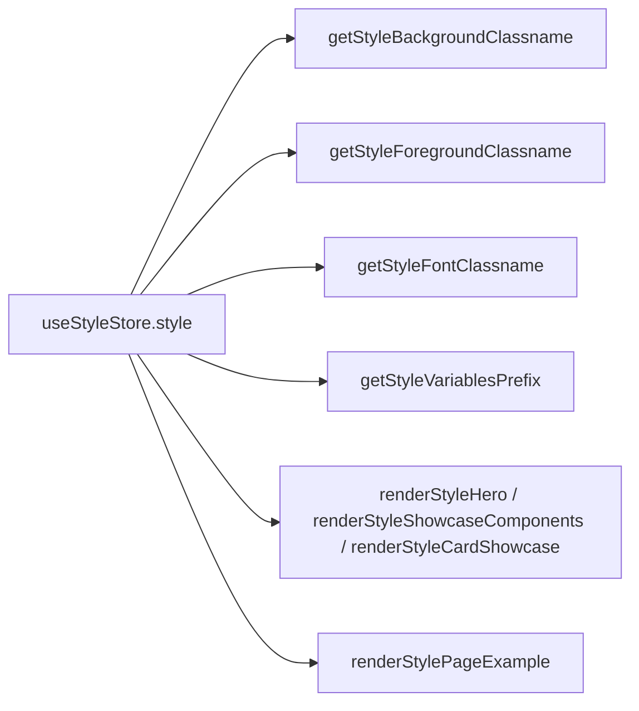

================================================================================
FILE: docs/project-audit/AUDIT_PROGRESS.md
================================================================================
# AUDIT_PROGRESS

Status legend: Not started / In progress / Complete / Blocked / Needs verification / Not applicable.

## Stage 1 — Repository discovery (Complete)

| Area | Status | Notes |
|---|---|---|
| Root configs, versions, scripts | Complete | package.json, tailwind.config.ts, next.config.mjs, components.json, registry.json read |
| Registry + style-selection logic | Complete | registry/styles.tsx, hooks/use-style-store.tsx, registry/registry-styles.ts, registry-ui.ts |
| Default + carbon + neon button | Complete | Baseline + 2 spot-checks read; other 9 styles' buttons not yet read |
| Global CSS + tokens (skim) | Complete | globals.css (1903 lines) skimmed; full token extraction pending Stage 4 |
| Fonts + tailwind mapping | Complete | lib/fonts.ts, font switch, tailwind fontFamily; unverified loaders noted |
| Routing + page examples (index) | Complete | Route groups + renderStylePageExample fallback quirks recorded |
| Git history (read-only) | Complete | 15-commit skim; no changes made |
| Initial docs (6 files) | Complete | README, PROJECT_OVERVIEW, REPOSITORY_STRUCTURE, STYLE_INVENTORY, COMPONENT_INVENTORY, this file |

## Per-style / per-component auditing

| Area | Style | Component | Status | Notes |
|---|---|---|---|---|
| Baseline | default | button | Complete | registry/default/ui/button.tsx:1-106 read; ButtonLink API noted |
| Pilot audit | carbon | button | Complete | components/carbon/button-vs-default.md; inset/halo focus, bordered secondary, ButtonLink absent (drift) |
| Pilot audit | linear | button | Complete | components/linear/button-vs-default.md; compact sizes, shadowed outline, offset-1 |
| Pilot audit | material | button | Complete | components/material/button-vs-default.md; pill shape, wide padding, secondary ghost |
| Pilot audit | catalyst | button | Complete | components/catalyst/button-vs-default.md; semibold, legacy-token link (convention), cn("") quirk |
| Pilot audit | spectrum | button | Complete | components/spectrum/button-vs-default.md; densest pill, vestigial next/link import |
| Pilot audit | wedges | button | Complete | components/wedges/button-vs-default.md; /50 translucent hovers, offset-1 |
| Pilot audit | moon | button | Complete | components/moon/button-vs-default.md; token-swap only, full ButtonLink parity |
| Pilot audit | lucid | button | Complete | components/lucid/button-vs-default.md; universal border system, ButtonLink parity |
| Pilot audit | snow | button | Needs verification | components/snow/button-vs-default.md; offset-width absence + radius mismatch unresolved |
| Pilot audit | neon | button | Complete | components/neon/button-vs-default.md; compact sizes, token swap |
| Pilot audit | libelle | button | Needs verification | components/libelle/button-vs-default.md; text-base, tinted destructive; unprefixed border token unresolved |
| Pilot matrix + index | all | button | Complete | components/button-MATRIX.md, COMPONENT_COMPARISON_INDEX.md |
| Component audit | all styles | other 46 components | Not started | — |
| Token audit | all | global tokens | Not started | STYLING_ARCHITECTURE, DESIGN_TOKEN_INVENTORY, STYLE_TOKEN_COMPARISON, TYPOGRAPHY_COMPARISON pending |
| Registry/routing audit | all | pages/showcases | Not started | STYLE_REGISTRY_AND_ROUTING, PAGE_EXAMPLES_AND_SHOWCASES pending |
| Index + upgrade guide | all | all | Not started | COMPONENT_COMPARISON_INDEX, UPGRADE_PRESERVATION_GUIDE, KNOWN_ISSUES pending |

## Blockers / open questions

1. Radius mismatches (default, snow) — Needs verification.
2. Per-style dark-mode coverage (globals vs themes.css) — Needs verification.
3. charts/board fallback intent (shared vs accidental) — Needs verification.
4. Unverified font families in tailwind config — Needs verification.
5. `components/ui` baseline provenance — Needs verification.
6. `utils/`, `code/`, `pages/`, `__registry__/` vs `public/r` — Not started.

## Resume point

Stage 1 complete; Button pilot complete (11 comparison docs + matrix + index, 2026-10-09).
Unresolved from pilot: snow focus-offset width + snow radius canonical value; libelle
`border-destructive/30` prefix intent; material variant-scoped offset generality.
Next: Stage 4 token/typography/styling docs, then remaining 46 components. No application
files modified (verified via `git status` — only `docs/project-audit/` changed).


================================================================================
FILE: docs/project-audit/COMPONENT_COMPARISON_INDEX.md
================================================================================
# COMPONENT_COMPARISON_INDEX

## Button (Complete — 11/11 styles audited 2026-10-09)

| Style | Compared Against | Main Difference Categories | Documentation | Status |
|---|---|---|---|---|
| Carbon | Default Button | FOCUS, BORDER, TOKEN_VALUE, MISSING_IMPLEMENTATION | `components/carbon/button-vs-default.md` | Complete |
| Linear | Default Button | DIMENSION, FOCUS, COLOR, SHADOW | `components/linear/button-vs-default.md` | Complete |
| Material | Default Button | SHAPE, DIMENSION, COLOR, FOCUS | `components/material/button-vs-default.md` | Complete |
| Catalyst | Default Button | TYPOGRAPHY, DIMENSION, COLOR, SHADOW, GLOBAL_STYLE | `components/catalyst/button-vs-default.md` | Complete |
| Spectrum | Default Button | SHAPE, DIMENSION, COLOR, TECHNICAL | `components/spectrum/button-vs-default.md` | Complete |
| Wedges | Default Button | FOCUS, COLOR, INTERACTION, DIMENSION | `components/wedges/button-vs-default.md` | Complete |
| Moon | Default Button | TOKEN_REFERENCE only (no component-level visual diff) | `components/moon/button-vs-default.md` | Complete |
| Lucid | Default Button | BORDER, DIMENSION | `components/lucid/button-vs-default.md` | Complete |
| Snow | Default Button | DIMENSION, SHAPE, FOCUS (unresolved offset) | `components/snow/button-vs-default.md` | Complete* |
| Neon | Default Button | DIMENSION, TOKEN_VALUE | `components/neon/button-vs-default.md` | Complete |
| Libelle | Default Button | TYPOGRAPHY, COLOR | `components/libelle/button-vs-default.md` | Complete* |

`*` Complete with flagged unresolved items (snow offset width + radius mismatch; libelle
unprefixed destructive border token). Consolidated view: `components/button-MATRIX.md`.

## Style-centric view (Button only)

| Style | Button identity in one line | Status |
|---|---|---|
| Moon | Default with moon tokens | Complete |
| Carbon | Inset/halo focus, bordered secondary, square | Complete |
| Linear | Compact, shadowed outline, offset-1 | Complete |
| Material | Pill, wide, secondary ghost | Complete |
| Catalyst | Semibold, compact, legacy-token link | Complete |
| Spectrum | Densest pill, fg-text outline | Complete |
| Wedges | Translucent hovers, offset-1 | Complete |
| Lucid | Universal border system | Complete |
| Snow | Compact, sm/lg radius steps, offset? | Complete* |
| Neon | Compact square token swap | Complete |
| Libelle | text-base, tinted destructive, primary outline | Complete* |

## All other components (Not audited)

Accordion, alert, alert-dialog, aspect-ratio, avatar, badge, breadcrumb, calendar, card,
carousel, chart, checkbox, collapsible, command, context-menu, data-table, dialog, drawer,
dropdown-menu, form, hover-card, input, input-otp, label, menubar, navigation-menu,
pagination, popover, progress, radio-group, resizable, scroll-area, select, separator,
sheet, sidebar, skeleton, slider, sonner, switch, table, tabs, textarea, toggle,
toggle-group, tooltip, typography — **Not audited** for any style. Presence-only inventory
in `COMPONENT_INVENTORY.md`; do not treat as identical to default.


================================================================================
FILE: docs/project-audit/COMPONENT_INVENTORY.md
================================================================================
# COMPONENT_INVENTORY

Verified 2026-10-09 by listing `registry/<style>/ui/` for all 12 styles.
Result: **identical filename sets — 47 files in every style** (no missing/extra per-style files
at the filename level). Content diffs are **not yet audited** (Stage 5); "Present" below means
"file exists", not "identical to default".

Status legend: `Present` = file exists, content unaudited; `Audited` = full vs-default
comparison doc exists (button only). Filename presence and audit status are tracked
separately — all other components remain `Present`/unaudited.

| Component (file) | Default | Carbon | Linear | Material | Catalyst | Spectrum | Wedges | Moon | Lucid | Snow | Neon | Libelle | Notes |
|---|---|---|---|---|---|---|---|---|---|---|---|---|---|
| accordion | Present | Present | Present | Present | Present | Present | Present | Present | Present | Present | Present | Present | Radix accordion |
| alert | Present | Present | Present | Present | Present | Present | Present | Present | Present | Present | Present | Present | — |
| alert-dialog | Present | Present | Present | Present | Present | Present | Present | Present | Present | Present | Present | Present | Radix alert-dialog |
| aspect-ratio | Present | Present | Present | Present | Present | Present | Present | Present | Present | Present | Present | Present | — |
| avatar | Present | Present | Present | Present | Present | Present | Present | Present | Present | Present | Present | Present | — |
| badge | Present | Present | Present | Present | Present | Present | Present | Present | Present | Present | Present | Present | — |
| breadcrumb | Present | Present | Present | Present | Present | Present | Present | Present | Present | Present | Present | Present | — |
| button | Present (baseline) | Audited | Audited | Audited | Audited | Audited | Audited | Audited | Audited | Audited (offset?) | Audited | Audited | All 12 read; 11 docs in `components/<style>/button-vs-default.md` + `components/button-MATRIX.md`; ButtonLink kept in moon/lucid/libelle only; snow offset + libelle border-token unresolved |
| calendar | Present | Present | Present | Present | Present | Present | Present | Present | Present | Present | Present | Present | day-picker + date-fns |
| card | Present | Present | Present | Present | Present | Present | Present | Present | Present | Present | Present | Present | — |
| carousel | Present | Present | Present | Present | Present | Present | Present | Present | Present | Present | Present | Present | embla |
| chart | Present | Present | Present | Present | Present | Present | Present | Present | Present | Present | Present | Present | recharts |
| checkbox | Present | Present | Present | Present | Present | Present | Present | Present | Present | Present | Present | Present | — |
| collapsible | Present | Present | Present | Present | Present | Present | Present | Present | Present | Present | Present | Present | — |
| command | Present | Present | Present | Present | Present | Present | Present | Present | Present | Present | Present | Present | cmdk |
| context-menu | Present | Present | Present | Present | Present | Present | Present | Present | Present | Present | Present | Present | — |
| data-table | Present | Present | Present | Present | Present | Present | Present | Present | Present | Present | Present | Present | tanstack table |
| dialog | Present | Present | Present | Present | Present | Present | Present | Present | Present | Present | Present | Present | — |
| drawer | Present | Present | Present | Present | Present | Present | Present | Present | Present | Present | Present | Present | vaul |
| dropdown-menu | Present | Present | Present | Present | Present | Present | Present | Present | Present | Present | Present | Present | — |
| form | Present | Present | Present | Present | Present | Present | Present | Present | Present | Present | Present | Present | RHF + zod |
| hover-card | Present | Present | Present | Present | Present | Present | Present | Present | Present | Present | Present | Present | — |
| input | Present | Present | Present | Present | Present | Present | Present | Present | Present | Present | Present | Present | — |
| input-otp | Present | Present | Present | Present | Present | Present | Present | Present | Present | Present | Present | Present | input-otp lib |
| label | Present | Present | Present | Present | Present | Present | Present | Present | Present | Present | Present | Present | — |
| menubar | Present | Present | Present | Present | Present | Present | Present | Present | Present | Present | Present | Present | — |
| navigation-menu | Present | Present | Present | Present | Present | Present | Present | Present | Present | Present | Present | Present | — |
| pagination | Present | Present | Present | Present | Present | Present | Present | Present | Present | Present | Present | Present | — |
| popover | Present | Present | Present | Present | Present | Present | Present | Present | Present | Present | Present | Present | — |
| progress | Present | Present | Present | Present | Present | Present | Present | Present | Present | Present | Present | Present | — |
| radio-group | Present | Present | Present | Present | Present | Present | Present | Present | Present | Present | Present | Present | — |
| resizable | Present | Present | Present | Present | Present | Present | Present | Present | Present | Present | Present | Present | react-resizable-panels |
| scroll-area | Present | Present | Present | Present | Present | Present | Present | Present | Present | Present | Present | Present | — |
| select | Present | Present | Present | Present | Present | Present | Present | Present | Present | Present | Present | Present | — |
| separator | Present | Present | Present | Present | Present | Present | Present | Present | Present | Present | Present | Present | — |
| sheet | Present | Present | Present | Present | Present | Present | Present | Present | Present | Present | Present | Present | — |
| sidebar | Present | Present | Present | Present | Present | Present | Present | Present | Present | Present | Present | Present | — |
| skeleton | Present | Present | Present | Present | Present | Present | Present | Present | Present | Present | Present | Present | — |
| slider | Present | Present | Present | Present | Present | Present | Present | Present | Present | Present | Present | Present | — |
| sonner | Present | Present | Present | Present | Present | Present | Present | Present | Present | Present | Present | Present | next-themes |
| switch | Present | Present | Present | Present | Present | Present | Present | Present | Present | Present | Present | Present | — |
| table | Present | Present | Present | Present | Present | Present | Present | Present | Present | Present | Present | Present | — |
| tabs | Present | Present | Present | Present | Present | Present | Present | Present | Present | Present | Present | Present | — |
| textarea | Present | Present | Present | Present | Present | Present | Present | Present | Present | Present | Present | Present | — |
| toggle | Present | Present | Present | Present | Present | Present | Present | Present | Present | Present | Present | Present | — |
| toggle-group | Present | Present | Present | Present | Present | Present | Present | Present | Present | Present | Present | Present | HEAD commit touched import path |
| tooltip | Present | Present | Present | Present | Present | Present | Present | Present | Present | Present | Present | Present | — |
| typography | Present | Present | Present | Present | Present | Present | Present | Present | Present | Present | Present | Present | Non-standard shadcn item |

## Non-`ui/` component layers (inventory only, diffs pending)

- Per-style `example/` + `examples/` demos (loaded by `lib/component-loader.tsx`), `blocks/`,
  `components/`, `hooks/`, `lib/`, `internal/`, hero/showcase/card-showcase/page-examples.
- Page examples per style: mail, dashboard, cards, tasks, playground, forms (SettingsProfile),
  music, authentication — all 12 styles; plus moon/charts, material/board, libelle/board,
  neon/board. `charts`/`board` fallback routing (`registry/styles.tsx:318-333`) needs Stage 6 audit.
- Site chrome `components/ui/` (47 + `animated-dialog`, `fullscreen-dialog`, `rich-badge`);
  baseline provenance unverified.
- `registry/registry-ui.ts` defines the same 47 items (incl. `typography`, `data-table`) with
  npm/registry dependencies — the authoritative item list for generation.


================================================================================
FILE: docs/project-audit/components/button-MATRIX.md
================================================================================
# Button — Cross-Style Matrix (vs Default)

All 12 implementations read 2026-10-09. Baseline `registry/default/ui/button.tsx`
(base `rounded-dft-md text-sm font-medium offset-2`; sizes `h-10/9/11`; exports
`Button, ButtonLink, buttonVariants`). Effects inferred from source.

| Style | Shape | Type | Density (default/sm/lg) | Focus | Outline | Secondary / Ghost | Destructive | ButtonLink | Doc |
|---|---|---|---|---|---|---|---|---|---|
| moon | token (`--moon-radius 0.6rem`) | = | = `h-10/9/11` | = | token swap | token swap | token swap | ✅ kept | `moon/button-vs-default.md` |
| carbon | square (0rem) | = | = `h-10/9/11` | **inset 1px ring, transparent ring + offset halo, dark offsets** | border-only, svg-hover | **bordered secondary** | token swap | ❌ absent (drift) | `carbon/button-vs-default.md` |
| linear | token (0.5rem) | = | compact `h-9/8/10` | offset-1 | **shadow + muted hover + dark fill** (+dup `shadow-sm`) | token swap | token swap | ❌ | `linear/button-vs-default.md` |
| material | **pill** | = | same heights, wider px | offset moved to `default` variant only | secondary-tone hover + svg-hover | **ghost hovers secondary** | token swap | ❌ | `material/button-vs-default.md` |
| catalyst | token (0.6rem) | **semibold** | compact, tight `px-2` sm | offset-1 | **shadow + secondary hover** | token swap | token swap | ❌ (+`cn(,"")` quirk) | `catalyst/button-vs-default.md` |
| spectrum | **pill** | = | **densest `h-8/7/9`**, `py-1.5` | = | asserts fg text | token swap | token swap | ❌ (**vestigial `next/link` import**) | `spectrum/button-vs-default.md` |
| wedges | token (0.5rem) | = | mild compact `h-9/9/10` | offset-1 | **`/50` translucent hover** | **ghost `/50` hover** | token swap | ❌ | `wedges/button-vs-default.md` |
| lucid | token (0.5rem) | = | compact, tightest `px-2` sm | = | token swap | **universal base `border` + per-variant tints; ghost/link `border-transparent`** | tinted border | ✅ kept | `lucid/button-vs-default.md` |
| snow | token (0.75rem CSS ⚠️) | = | compact `h-9/8/10` | **offset width missing (?)** | token swap | token swap | token swap | ❌ | `snow/button-vs-default.md` |
| neon | square (0rem) | = | compact `h-9/8/10` | = | token swap | token swap | token swap | ❌ | `neon/button-vs-default.md` |
| libelle | square (0rem) | **`text-base`** | = `h-10/9/11` | = | **primary-colored** | token swap | **tint (`/15`→`/35`)** | ✅ kept | `libelle/button-vs-default.md` |

## Patterns

- **Density ladder** (default size): default/moon/carbon/libelle `h-10` → wedges/snow/neon/linear/lucid `h-9`
  → material/catalyst `h-10 wide` → spectrum `h-8`. Compact styles drop per-size radius utilities.
- **Shape**: pill (material, spectrum) / square (carbon, neon, libelle) / token radius (rest).
- **Ghost hover**: accent (default-like) everywhere except material (secondary) and wedges (`/50`).
- **ButtonLink kept**: moon, lucid, libelle only. Absent in 8 styles with zero in-repo breakage
  (all consumers use local demo components) — drift, not design.
- **Icon sizing**: `size-4` universal; sole exception spectrum `icon-sm` (`size-3.5`).


================================================================================
FILE: docs/project-audit/components/carbon/button-vs-default.md
================================================================================
# Carbon Button vs Default

## 1. Audit Metadata

- Style: carbon | Component: button | Baseline: `registry/default/ui/button.tsx:1-106`
- Alternative: `registry/carbon/ui/button.tsx:1-59`
- Audit date: 2026-10-09 | Status: Complete | Method: full source read, both files

## 2. Executive Summary

Carbon keeps Default's 6 variants, 6 sizes, and dimensions, but reworks the **focus
system** (inset 1px ring, transparent visible-ring, dark-mode offsets) and restyles
**outline/secondary** (border-token edge, no forced background). It drops the `ButtonLink`
export. Font is IBM Plex Sans (inherited). Radius resolves to square (0rem).

## 3. Visual Differences

**Base** (`carbon:8` vs `default:9`): prefix `dft` → `cb` throughout, plus —
- Added `ring-inset`: focus ring renders inside the button edge rather than outside.
  [FOCUS, intentional]
- Added `transition-all duration-100 ease-in-out` alongside retained `transition-colors`
  (conflicting transition utilities; tailwind-merge at render keeps both classes in the
  cva string — last-in-CSS-wins applies, effectively a fast all-property transition).
  [TRANSITION, intentional]
- Replaced `focus-visible:ring-dft-ring` with `focus-visible:ring-transparent` +
  `focus:ring-cb-background` / `focus-visible:ring-cb-background` with
  `focus:ring-offset-cb-ring` / `focus-visible:ring-offset-cb-ring`: the visible ring
  itself is transparent and the offset carries the accent color — an "offset halo"
  instead of a solid ring. [FOCUS, COLOR, intentional]
- Added `focus:ring-1` / `focus-visible:ring-1` (1px vs default 2px) and
  `dark:focus:ring-offset-1` / `dark:focus-visible:ring-offset-1` (tighter dark offset).
  [FOCUS, intentional]
- Removed `next/link` import; no other base class removed.

**Variants** (lines 12-21):
- `outline`: `border-dft-input bg-dft-background` → `border-cb-border` (no background
  assertion — transparent until hover) + added `[&_svg]:hover:text-cb-accent-foreground`
  (icon follows text color on hover). Flatter, edge-only resting state. [BORDER, COLOR,
  intentional]
- `secondary`: added `border border-cb-border` (default secondary is borderless).
  [BORDER, intentional]
- `default`, `destructive`, `ghost`, `link`: prefix swap only.

**Sizes** (lines 24-29): identical to Default (`h-10/9/11`, `px-4/3`, `px-8`, square icons).
No dimension difference. Radius utilities resolve square via `--cb-radius: 0rem`
(`app/globals.css:185`) vs default 0.4rem. [SHAPE via TOKEN_VALUE, intentional]

**States/icons**: hover `/90`-`/80` opacity, `disabled:` handling, `gap-2`,
`[&_svg]:size-4` icon sizing unchanged.

## 4. Token Dependencies

`cb-*` equivalents of all `dft-*` tokens; `--cb-ring: 55.65% 0.24 261.95`,
`--cb-primary: 55.65% 0.24 261.95` (blue), `--cb-radius: 0rem`. Focus design depends on
`--cb-background` (ring color) + `--cb-ring` (offset color) interplay — both must survive
migration. [TOKEN_REFERENCE, TOKEN_VALUE]

## 5. Typography

Inherited `font-carbon` (IBM Plex Sans) via `registry/styles.tsx:229-230`. No
component-level type change. [GLOBAL_STYLE]

## 6. API / Structural Exceptions

- **Missing `ButtonLink` export** (and `ButtonLinkProps`, `iconLeft`/`iconRight`, `next/link`
  import). Consumer check: no in-repo file imports `ButtonLink` from any style's
  `ui/button` — sink/examples define local demo components using only `Button`
  (e.g. `registry/carbon/internal/sink/components/button-link.tsx:1-5`,
  `registry/carbon/examples/button-link.tsx:1-5`). Verdict: **no in-repo breakage**;
  classify as API divergence, likely copy drift rather than design (a link-with-icons
  helper is not Carbon-specific). External registry consumers expecting `ButtonLink`
  from carbon would break → `MISSING_IMPLEMENTATION`, `POTENTIAL_REGRESSION`.
- `Button`/`asChild`/Slot behavior unchanged.

## 7. Upgrade Preservation

Must re-apply: inset-ring focus stack, transparent-ring + offset-halo colors, 1px widths,
dark offsets, `transition-all duration-100 ease-in-out`, outline (border-only + svg-hover)
and secondary (bordered) treatments, `cb` token namespace. Do not copy `ButtonLink`
absence blindly — decide whether to restore it for parity.

## 8. Verification

Both files read fully; consumer grep for `ButtonLink` across `registry/` and
`components/` performed. Visual effects inferred from source. No unresolved items.


================================================================================
FILE: docs/project-audit/components/catalyst/button-vs-default.md
================================================================================
# Catalyst Button vs Default

## 1. Audit Metadata

- Style: catalyst | Component: button | Baseline: `registry/default/ui/button.tsx:1-106`
- Alternative: `registry/catalyst/ui/button.tsx:1-60`
- Audit date: 2026-10-09 | Status: Complete | Method: full source read, both files

## 2. Executive Summary

Catalyst pairs **semibold type + compact density** with a **secondary-toned outline**
(shadowed) and a tighter focus offset. Its `link` variant uses the **unprefixed legacy
`text-foreground`** token — consistent with catalyst-wide convention, not a typo. A
`cn(…, "")` empty-string argument in render is a harmless technical quirk. No `ButtonLink`.

## 3. Visual Differences

**Base** (line 8): `font-medium` → `font-semibold` (only style changing button weight);
`ring-offset-2` → `ring-offset-1`. [TYPOGRAPHY, FOCUS, intentional]

**Variants** (lines 12-21):
- `outline`: `border-catalyst-input` (no background assertion) + `hover:bg-catalyst-secondary
  hover:text-catalyst-secondary-foreground` + `shadow-sm` — shadowed, secondary-filled
  hover. [COLOR, SHADOW, intentional]
- `link`: `text-foreground` — the legacy unprefixed token, not `text-catalyst-primary`.
  Verified as convention: unprefixed `text-foreground` recurs across catalyst components
  (`alert.tsx:7,11`, `badge.tsx:17`, `typography.tsx:29`, `breadcrumb.tsx:53,69`,
  `sheet.tsx:111`, `context-menu.tsx:147`). Inferred effect: link color follows the
  global legacy theme rather than the catalyst namespace. [COLOR/GLOBAL_STYLE,
  intentional convention — migration must preserve the legacy token, not "fix" it]
- Others: prefix swap only.

**Sizes** (lines 24-29): `default h-9 px-3 py-2`, `sm h-8 rounded-catalyst-md px-2`,
`lg h-10 rounded-catalyst-md px-7`, icons `h-9/8/10` — compact with notably tight `px-2`
sm. [DIMENSION, intentional]

## 4. Token Dependencies

`catalyst-*` namespace; `--catalyst-primary: 0.274 0.006 286.033` (near-black),
`--catalyst-radius: 0.6rem`; plus legacy `--foreground` dependency via link variant.
[TOKEN_REFERENCE, TOKEN_VALUE]

## 5. Typography

Semibold is component-level (base string). Family inherited Inter (`font-sans`).
[TYPOGRAPHY]

## 6. API / Structural Exceptions

- Missing `ButtonLink`; consumers use `Button` only — no in-repo breakage; drift.
  [MISSING_IMPLEMENTATION]
- `cn(buttonVariants({ variant, size, className }), "")` (`catalyst:50`): empty-string arg
  is a no-op. [TECHNICAL, potentially accidental — harmless, record once]

## 7. Upgrade Preservation

Re-apply: semibold base, `offset-1`, secondary-hover shadowed outline, tight sizes,
unprefixed link token (do not "correct" to `text-catalyst-primary` without designer
sign-off), `catalyst` namespace. Drop the `""` arg.

## 8. Verification

Both files read fully; `text-foreground` convention verified by grep across catalyst `ui/`;
consumer grep done. No unresolved items.


================================================================================
FILE: docs/project-audit/components/libelle/button-vs-default.md
================================================================================
# Libelle Button vs Default

## 1. Audit Metadata

- Style: libelle | Component: button | Baseline: `registry/default/ui/button.tsx:1-106`
- Alternative: `registry/libelle/ui/button.tsx:1-106`
- Audit date: 2026-10-09 | Status: Complete | Method: full source read, both files

## 2. Executive Summary

Libelle keeps full API parity (`ButtonLink` included) and default dimensions, but makes
the boldest variant moves in the system: base type steps up to **`text-base`**, the
**destructive variant becomes a tint** (`/15` bg, `/35` hover, `border-destructive/30`
with an unprefixed destructive border token), and **outline becomes primary-colored**
text + border. Outfit inherited. Square corners.

## 3. Visual Differences

**Base** (line 9): `text-sm` → `text-base` (only style changing button font size);
prefix swap otherwise. [TYPOGRAPHY, intentional]

**Variants** (lines 12-22):
- `destructive`: `border border-destructive/30 bg-libelle-destructive/15
  text-libelle-destructive hover:bg-libelle-destructive/35` — translucent tint instead of
  solid fill; note `border-destructive/30` references the **unprefixed legacy**
  `--destructive` token while everything else is `libelle-*`. Inferred: soft
  pink/red tint button. [COLOR, intentional design; the unprefixed border token is
  POTENTIAL_REGRESSION-or-convention — unresolved, cf. catalyst which uses unprefixed
  tokens deliberately elsewhere]
- `outline`: `border-libelle-primary text-libelle-primary` (primary-colored edge + text
  vs default neutral input-border) + accent hover. [COLOR, intentional]
- Others: prefix swap only.

**Sizes** (lines 25-30): identical to Default (`h-10/9/11`, same paddings, same radius
utilities). No dimension difference. Square via `--libelle-radius: 0rem`.

**States/icons**: unchanged (`size-4` icons, same hovers/disabled).

## 4. Token Dependencies

`libelle-*` namespace; `--libelle-primary: 0.3 0.205674 264.052` (deep blue),
`--libelle-destructive: 0.54 0.218255 29.4805`, `--libelle-radius: 0rem`
(`app/globals.css:230-258`); plus legacy `--destructive` via the tint border.
[TOKEN_REFERENCE, TOKEN_VALUE]

## 5. Typography

`text-base` is component-level. Family Outfit via `registry/styles.tsx:249-250`.
[TYPOGRAPHY + GLOBAL_STYLE]

## 6. API / Structural Exceptions

None — full `ButtonLink` parity (lines 61-106). (Minor: `Button` render uses
`<Comp …></Comp>` instead of self-closing — no behavioral effect.) [TECHNICAL, trivial]

## 7. Upgrade Preservation

Re-apply: `text-base`, tinted destructive (all four classes incl. border token choice —
confirm prefix intent), primary outline, `libelle` namespace. Keep `ButtonLink`.

## 8. Verification

Both files read fully. **Unresolved**: whether `border-destructive/30` (unprefixed) is a
deliberate cross-token reference or should be `border-libelle-destructive/30`.


================================================================================
FILE: docs/project-audit/components/linear/button-vs-default.md
================================================================================
# Linear Button vs Default

## 1. Audit Metadata

- Style: linear | Component: button | Baseline: `registry/default/ui/button.tsx:1-106`
- Alternative: `registry/linear/ui/button.tsx:1-59`
- Audit date: 2026-10-09 | Status: Complete | Method: full source read, both files

## 2. Executive Summary

Linear combines **compact density** (same reduced size table as neon) with a restyled
**outline variant** (shadow + muted hover + dark-mode accent fill) and a tighter
**focus offset** (`offset-1`). No `ButtonLink`. Inter inherited.

## 3. Visual Differences

**Base** (line 8): prefix swap + `focus-visible:ring-offset-2` → `focus-visible:ring-offset-1`
(tighter focus halo). [FOCUS, intentional]

**Variants** (lines 12-21):
- `outline`: `border-linear-input bg-linear-background hover:bg-linear-muted
  hover:text-linear-accent-foreground shadow-sm dark:bg-linear-accent/70 shadow-sm`
  (`linear:17`). Differences: hover fill is `muted` (not `accent`) with accent-foreground
  text; added `shadow-sm` (written twice — duplicate class, single rendered effect);
  `dark:bg-linear-accent/70` gives the outline a filled dark-mode resting state.
  [COLOR, SHADOW, INTERACTION; the duplicated `shadow-sm` is POTENTIAL_REGRESSION/minor —
  harmless but likely accidental duplication]
- `secondary`, `ghost`, `link`, `default`, `destructive`: prefix swap only.

**Sizes** (lines 24-29): `default h-9 px-3.5` (no `py-2`), `sm h-8 px-2.5`,
`lg h-10 px-5`, icons `h-9 w-9` / `h-8 w-8` / `h-10 w-10` — one step denser than default,
no per-size radius utilities. [DIMENSION, intentional]

**States/icons**: hover opacities, `disabled:`, `gap-2`, `size-4` icons unchanged.

## 4. Token Dependencies

`linear-*` namespace; `--linear-primary/ring: 55.93% 0.158 274.41`,
`--linear-radius: 0.5rem` (`app/globals.css:576-602`). Outline hover relies on
`--linear-muted` vs `--linear-accent` distinction — preserve both. [TOKEN_REFERENCE,
TOKEN_VALUE]

## 5. Typography

Inherited `font-sans` (Inter). No component-level change. [GLOBAL_STYLE]

## 6. API / Structural Exceptions

Missing `ButtonLink` export; consumers use local demo components
(`registry/linear/examples/button-link.tsx`, `internal/sink/components/button-link.tsx`
use `Button` only) — no in-repo breakage; drift, not design. [MISSING_IMPLEMENTATION]

## 7. Upgrade Preservation

Re-apply: compact sizes, `offset-1` focus, outline shadow + muted-hover + dark fill,
`linear` namespace. De-duplicate `shadow-sm` deliberately (keep one).

## 8. Verification

Both files read fully; consumer grep done. Unresolved: none material (duplicate-shadow
verdict is minor and recorded).


================================================================================
FILE: docs/project-audit/components/lucid/button-vs-default.md
================================================================================
# Lucid Button vs Default

## 1. Audit Metadata

- Style: lucid | Component: button | Baseline: `registry/default/ui/button.tsx:1-106`
- Alternative: `registry/lucid/ui/button.tsx:1-107`
- Audit date: 2026-10-09 | Status: Complete | Method: full source read, both files

## 2. Executive Summary

Lucid keeps the full API (`ButtonLink` included — 1 of 4 styles to do so) but gives every
variant a **visible border treatment**: a universal base `border` plus per-variant
border tints (including translucent `border-transparent` on ghost/link). Combined with
compact sizes and tight `sm` padding, it reads as an outlined/linear aesthetic. Inter
inherited.

## 3. Visual Differences

**Base** (line 9): prefix swap + added `border` (border-width without color → currentColor
edge on all variants until overridden). [BORDER, intentional — the style's signature]

**Variants** (lines 12-23):
- `default`: appends `border-lucid-primary/30` (tinted edge on the solid button).
- `destructive`: appends `border-lucid-destructive/20`.
- `secondary`: `border border-lucid-input` added (bordered secondary, cf. carbon).
- `ghost`: `border-transparent` added (reserves border width so hover doesn't shift
  layout — layout-stability detail).
- `link`: `border-transparent` added (same stability rationale).
- `outline`: prefix swap only (`border border-lucid-border`).
[All BORDER/COLOR, intentional as a set]

**Sizes** (lines 26-31): `default h-9 px-2.5 py-2`, `sm h-8 px-2` (tightest horizontal
padding in the system), `lg h-10 px-8`, icons `h-9/8/10`. [DIMENSION, intentional]

## 4. Token Dependencies

`lucid-*` namespace; monochrome tokens (`--lucid-primary: 29.31% 0 0`,
`--lucid-ring: 29.31% 0 0`, `--lucid-radius: 0.5rem`) (`app/globals.css:428-454`).
Border tints use opacity modifiers on semantic tokens. [TOKEN_REFERENCE, TOKEN_VALUE]

## 5. Typography

Inherited `font-sans` (Inter). No component-level change. [GLOBAL_STYLE]

## 6. API / Structural Exceptions

None — `ButtonLinkProps`, `ButtonLink` with icons, `asChild`, `next/link` all retained
(lines 62-107). Full parity with Default.

## 7. Upgrade Preservation

Re-apply: base `border`, all five per-variant border treatments (especially the
`border-transparent` stability trick on ghost/link), tight sizes, `lucid` namespace.
High-fidelity style — port carefully; dropping the base `border` would collapse the
whole variant system.

## 8. Verification

Both files read fully. Effects inferred from source. No unresolved items.


================================================================================
FILE: docs/project-audit/components/material/button-vs-default.md
================================================================================
# Material Button vs Default

## 1. Audit Metadata

- Style: material | Component: button | Baseline: `registry/default/ui/button.tsx:1-106`
- Alternative: `registry/material/ui/button.tsx:1-60`
- Audit date: 2026-10-09 | Status: Complete | Method: full source read, both files

## 2. Executive Summary

Material's identity is **pill shape** (`rounded-full` base, no per-size radii) with
**secondary-toned outline/ghost hovers** and wider padding. Focus ring drops the offset
width from base (offset moved into the `default` variant only). No `ButtonLink`. Roboto
inherited.

## 3. Visual Differences

**Base** (line 8): `rounded-dft-md` → `rounded-full` (fully pill; per-size radius
utilities removed everywhere). `focus-visible:ring-offset-2` removed from base.
[SHAPE, intentional — strongest material marker]

**Variants** (lines 12-22):
- `default`: appends `ring-offset-1 ring-offset-material-background` — only the primary
  variant carries an explicit offset width; all other variants render the offset color
  with default (0) width. Inferred effect: visible focus offset primarily on primary
  buttons. [FOCUS, intentional-or-quirk — recorded as intentional placement with
  unresolved generality; see §8]
- `outline`: `… hover:bg-material-secondary hover:text-material-secondary-foreground
  [&_svg]:hover:text-material-secondary-foreground` — secondary-toned hover instead of
  accent; icon follows text. [COLOR, intentional]
- `ghost`: `hover:bg-material-secondary hover:text-material-secondary-foreground`
  (default ghost hovers `accent`). [COLOR, intentional]
- `secondary`, `destructive`, `link`: prefix swap only.

**Sizes** (lines 25-30): heights match default steps (`h-10/9/11`, icons same) but wider
padding — `default h-10 px-5 py-2` (vs `px-4`), `sm h-9 px-4` (vs `px-3`), `lg h-11 px-8`
(same). No per-size radius. [DIMENSION, intentional]

## 4. Token Dependencies

`material-*` namespace; `--material-primary: 0.49 0.1992 260.6` (blue),
`--material-secondary: 0.962 0 255.585`, `--material-radius: 0.75rem` (largely
superseded by `rounded-full` at component level) (`app/globals.css:969-991`).
[TOKEN_REFERENCE, TOKEN_VALUE]

## 5. Typography

Inherited `font-material` (Roboto) via `registry/styles.tsx:233-234`. No component-level
change. [GLOBAL_STYLE]

## 6. API / Structural Exceptions

Missing `ButtonLink`; consumers use `Button` only
(`registry/material/examples/button-link.tsx`, sink likewise) — no in-repo breakage;
drift. [MISSING_IMPLEMENTATION]

## 7. Upgrade Preservation

Re-apply: `rounded-full` base + radius-less sizes, wider px, secondary-toned
outline/ghost hovers (+ svg-hover), variant-scoped offset classes, `material` namespace.
Reconsider whether the offset should stay variant-scoped or return to base during
migration (flag for designer).

## 8. Verification

Both files read fully; consumer grep done. Unresolved: whether variant-scoped
`ring-offset-1` (vs base-level) is deliberate Material behavior or an editing slip —
recorded as intentional placement, generality unresolved.


================================================================================
FILE: docs/project-audit/components/moon/button-vs-default.md
================================================================================
# Moon Button vs Default

## 1. Audit Metadata

- Style: moon | Component: button | Baseline: `registry/default/ui/button.tsx:1-106`
- Alternative: `registry/moon/ui/button.tsx:1-106`
- Audit date: 2026-10-09 | Status: Complete | Method: full source read, both files

## 2. Executive Summary

Moon Button is a **pure token-namespace swap** of Default. No class added, removed, or
reordered beyond `dft` → `moon`; structure, API (`Button`, `ButtonLink`, `buttonVariants`),
variants, sizes, and icon handling are identical. Visual identity comes entirely from
global token values + the inherited Inter font.

## 3. Visual Differences

**None at component level.** Base (line 9), all 6 variants (lines 13-22), all 6 sizes
(lines 25-30), `defaultVariants`, disabled/hover/focus treatment, and `[&_svg]:size-4`
icon sizing match Default exactly modulo prefix.

## 4. Token Dependencies

Every `dft-*` reference maps to the `moon-*` equivalent (e.g. `bg-dft-primary` →
`bg-moon-primary`, `rounded-dft-md` → `rounded-moon-md`, `ring-offset-dft-background` →
`ring-offset-moon-background`). Resolved values differ globally (`--moon-primary:
46% 0.1683 280.94`, `--moon-radius: 0.6rem` vs `--dft-primary: var(--dft-color-primary-600)`
[0.511 0.262 276.966], `--dft-radius: 0.4rem`; `app/globals.css`). Radius consequence:
moon buttons render more rounded than default (0.6rem vs 0.4rem base). [TOKEN_REFERENCE,
TOKEN_VALUE, GLOBAL_STYLE — intentional]

## 5. Typography

No component-level typography. Moon inherits Inter via `font-sans`
(`registry/styles.tsx:243-244`). No difference. [GLOBAL_STYLE]

## 6. API / Structural Exceptions

None. `ButtonLinkProps` with `iconLeft`/`iconRight`, `ButtonLink`, `asChild`/Slot, and
`next/link` import all retained (lines 61-106). No compatibility concern.

## 7. Upgrade Preservation

Re-apply only the `dft` → `moon` prefix mapping (or keep the file as a copy of the new
default with prefix replaced). No bespoke classes, variants, or API to preserve. Lowest
migration risk of all styles.

## 8. Verification

Both files read in full. No unresolved questions. All visual consequences inferred from
source (no browser check).


================================================================================
FILE: docs/project-audit/components/neon/button-vs-default.md
================================================================================
# Neon Button vs Default

## 1. Audit Metadata

- Style: neon | Component: button | Baseline: `registry/default/ui/button.tsx:1-106`
- Alternative: `registry/neon/ui/button.tsx:1-60`
- Audit date: 2026-10-09 | Status: Complete | Method: full source read, both files

## 2. Executive Summary

Neon is a token swap plus a **uniform density reduction**: every size shrinks one step
(`h-10→h-9`, `h-9→h-8`, `h-11→h-10`) with tighter padding, and size variants drop the
explicit radius utility. Variants are prefix-only swaps. No `ButtonLink`. Font is Poppins
(inherited). Square corners via `--neon-radius: 0rem`.

## 3. Visual Differences

**Base** (line 8): `dft` → `neon` prefix only. Focus (`ring-2`, `offset-2`), transitions,
disabled, icon sizing (`size-4`) unchanged.

**Variants** (lines 12-21): prefix swap only — including outline keeping
`bg-neon-background`. No variant restyling (unlike carbon/material/catalyst).

**Sizes** (lines 24-29 vs default lines 25-30):

| Size | Default | Neon | Effect |
|---|---|---|---|
| default | `h-10 px-4 py-2` | `h-9 px-3.5 py-2` | shorter, narrower |
| sm | `h-9 rounded-dft-md px-3` | `h-8 px-2.5` | shorter, narrower, no explicit radius class |
| lg | `h-11 rounded-dft-md px-8` | `h-10 px-6` | shorter, narrower, no explicit radius class |
| icon / icon-sm / icon-lg | `h-10 w-10` / `h-9 w-9` / `h-11 w-11` | `h-9 w-9` / `h-8 w-8` / `h-10 w-10` | each one step smaller |

[DIMENSION, intentional — the style's compact density identity. Note sm/lg rely on the
base `rounded-neon-md` (square) rather than restating radius.]

## 4. Token Dependencies

`neon-*` equivalents throughout; `--neon-primary: 63.01% 0.1238 162.83` (green),
`--neon-ring: 75.01% 0.1238 162.83`, `--neon-radius: 0rem` (`app/globals.css:538-564`).
[TOKEN_REFERENCE, TOKEN_VALUE]

## 5. Typography

Inherited `font-poppins` (Poppins) via `registry/styles.tsx:247-248`. No component-level
type change (`text-sm font-medium` retained). [GLOBAL_STYLE]

## 6. API / Structural Exceptions

Missing `ButtonLink` export (+ props, `next/link` import) — same consumer analysis as
carbon: no in-repo importer of `ButtonLink` from `ui/button`
(`registry/neon/examples/button-link.tsx` uses `Button` + `link` variant only), so no
in-repo breakage. Classify as API divergence, likely drift. [MISSING_IMPLEMENTATION,
POTENTIAL_REGRESSION]

## 7. Upgrade Preservation

Re-apply: compact size table (all six sizes), `neon` namespace, square radius. Decide on
`ButtonLink` parity. No bespoke variant/focus logic to preserve.

## 8. Verification

Both files read fully; consumer grep done. Effects inferred from source. No unresolved items.


================================================================================
FILE: docs/project-audit/components/snow/button-vs-default.md
================================================================================
# Snow Button vs Default

## 1. Audit Metadata

- Style: snow | Component: button | Baseline: `registry/default/ui/button.tsx:1-106`
- Alternative: `registry/snow/ui/button.tsx:1-61`
- Audit date: 2026-10-09 | Status: Complete | Method: full source read, both files

## 2. Executive Summary

Snow is near-token-swap with compact sizes and mixed radius utilities (`rounded-snow-sm`
on sm, `rounded-snow-lg` on lg — the only style using non-`md` radius utilities on
button). The base string **appears to drop the ring-offset width**, leaving only the
offset color — flagged as the pilot's main unresolved accessibility question. No
`ButtonLink`. Inter inherited.

## 3. Visual Differences

**Base** (line 9): prefix swap; class sequence `… focus-visible:ring-snow-ring  disabled:…`
(double space) shows `ring-offset-snow-background` (color) but no `ring-offset-N` width
class — Default has `focus-visible:ring-offset-2`. Inferred effect: focus ring renders
without offset gap. [FOCUS, ACCESSIBILITY — **unresolved**: could be deliberate minimalism
or an editing slip; needs designer/browser confirmation]

**Variants** (lines 12-22): prefix swap only (outline keeps `bg-snow-background`).

**Sizes** (lines 25-30): `default h-9 px-4 py-2`, `sm h-8 rounded-snow-sm px-3`,
`lg h-10 rounded-snow-lg px-8`, icons `h-9/8/10`. The sm/lg radius utilities are unique
in the system; note `--snow-radius: 0.75rem` in CSS vs `0.4rem` in `registry-styles.ts`
(prior unresolved mismatch now has a visible consumer). [DIMENSION, SHAPE, intentional;
radius-mismatch stays unresolved]

## 4. Token Dependencies

`snow-*` namespace; `--snow-primary: 0% 0 0` (black), `--snow-ring: 89% 0.0602 258.65`,
`--snow-radius: 0.75rem` (`app/globals.css:466-492`). [TOKEN_REFERENCE, TOKEN_VALUE]

## 5. Typography

Inherited `font-sans` (Inter). No component-level change. [GLOBAL_STYLE]

## 6. API / Structural Exceptions

Missing `ButtonLink`; consumers use `Button` only — no in-repo breakage; drift.
[MISSING_IMPLEMENTATION]

## 7. Upgrade Preservation

Re-apply: compact sizes, sm/lg radius utilities, `snow` namespace. Resolve the
offset-width question before migrating — either restore `ring-offset-2`-equivalent or
record offset-less focus as intended.

## 8. Verification

Both files read fully; consumer grep done. **Unresolved**: (1) missing offset width —
intent vs slip; (2) which snow radius (0.75 CSS vs 0.4 registry) is canonical.


================================================================================
FILE: docs/project-audit/components/spectrum/button-vs-default.md
================================================================================
# Spectrum Button vs Default

## 1. Audit Metadata

- Style: spectrum | Component: button | Baseline: `registry/default/ui/button.tsx:1-106`
- Alternative: `registry/spectrum/ui/button.tsx:1-61`
- Audit date: 2026-10-09 | Status: Complete | Method: full source read, both files

## 2. Executive Summary

Spectrum is the **densest** style (smallest heights: `h-8/7/9`) with **pill shape**
(`rounded-full`) and an outline that asserts foreground text. Its `icon-sm` uniquely
shrinks icons (`size-3.5`). It imports `next/link` but defines no `ButtonLink` —
a vestigial import. Ubuntu inherited.

## 3. Visual Differences

**Base** (line 9): `rounded-dft-md` → `rounded-full`; prefix swap; all states unchanged.
[SHAPE, intentional]

**Variants** (lines 12-22):
- `outline`: `border-spctm-input` + added `text-spctm-foreground` (only style asserting
  resting text color on outline) + accent hover. [COLOR, intentional]
- Others: prefix swap only.

**Sizes** (lines 25-30): `default h-8 px-4 py-1.5` (also the only style changing `py`),
`sm h-7 px-2.5`, `lg h-9 px-6`, icons `h-8/7/9`; `icon-sm` appends `[&_svg]:size-3.5`
overriding the base `size-4` — smallest icon treatment in the system. [DIMENSION,
intentional]

## 4. Token Dependencies

`spctm-*` namespace (note truncated prefix); semantic tokens alias
`--spctm-color-primary-600` etc. (`app/globals.css:868-886`); `--spctm-radius: 0.4rem`
(mostly superseded by `rounded-full`). [TOKEN_REFERENCE, TOKEN_VALUE]

## 5. Typography

Inherited `font-spectrum` (Ubuntu) via `registry/styles.tsx:237-238`. No component-level
change. [GLOBAL_STYLE]

## 6. API / Structural Exceptions

- No `ButtonLink` export, yet `import Link, { LinkProps } from "next/link"` remains at
  line 3 — the only style with the import but not the component. Verdict: leftover from a
  deletion (drift), not design; harmless at runtime (unused import) but a lint signal.
  [TECHNICAL, POTENTIAL_REGRESSION]
- Consumers use `Button` only — no in-repo breakage. [MISSING_IMPLEMENTATION for the export]

## 7. Upgrade Preservation

Re-apply: `rounded-full`, densest size table incl. `py-1.5` and `icon-sm` svg override,
outline foreground-text assertion, `spctm` namespace. Remove the unused `next/link`
import (or restore `ButtonLink` for parity — designer call).

## 8. Verification

Both files read fully; consumer grep done. Effects inferred from source. No unresolved items.


================================================================================
FILE: docs/project-audit/components/wedges/button-vs-default.md
================================================================================
# Wedges Button vs Default

## 1. Audit Metadata

- Style: wedges | Component: button | Baseline: `registry/default/ui/button.tsx:1-106`
- Alternative: `registry/wedges/ui/button.tsx:1-59`
- Audit date: 2026-10-09 | Status: Complete | Method: full source read, both files

## 2. Executive Summary

Wedges is a light-touch style: prefix swap + `offset-1` focus + **translucent `/50`
hovers on outline and ghost** + mildly compact sizes. No `ButtonLink`. Inter inherited.

## 3. Visual Differences

**Base** (line 8): `focus-visible:ring-offset-2` → `ring-offset-1 ring-offset-wedges-background`
(note: offset width expressed without the `focus-visible:` variant prefix, plus a double
space in the string — cosmetic only). Net effect: tighter focus halo. [FOCUS, intentional;
double space TECHNICAL/harmless]

**Variants** (lines 12-21):
- `outline`: `border-wedges-border` (no bg) + `hover:bg-wedges-accent/50` (translucent
  hover — unique opacity among styles). [COLOR, INTERACTION, intentional]
- `ghost`: `hover:bg-wedges-accent/50` (same translucency). [COLOR, intentional]
- Others: prefix swap only.

**Sizes** (lines 24-29): `default h-9 px-4 py-2`, `sm h-9 rounded-wedges-md px-3`,
`lg h-10 rounded-wedges-md px-8`, icons `h-9/8/10` — default/sm heights match default's
sm, lg one step down. [DIMENSION, intentional]

## 4. Token Dependencies

`wedges-*` namespace; `--wedges-primary: 54.33% 0.2313 287.51` (purple),
`--wedges-ring: var(--wedges-primary)`, `--wedges-radius: 0.5rem`
(`app/globals.css:364-393`). [TOKEN_REFERENCE, TOKEN_VALUE]

## 5. Typography

Inherited `font-sans` (Inter). No component-level change. [GLOBAL_STYLE]

## 6. API / Structural Exceptions

Missing `ButtonLink`; consumers use `Button` only — no in-repo breakage; drift.
[MISSING_IMPLEMENTATION]

## 7. Upgrade Preservation

Re-apply: `/50` translucent outline/ghost hovers, `offset-1` focus, mildly compact sizes,
`wedges` namespace. Normalize the double space.

## 8. Verification

Both files read fully; consumer grep done. No unresolved items.


================================================================================
FILE: docs/project-audit/PROJECT_OVERVIEW.md
================================================================================
# PROJECT_OVERVIEW — Shadcn Marketplace

Audit date: 2026-10-09. Method: source inspection only (no runtime verification).
All paths repository-relative.

## 1. What the application does

A marketing + distribution site ("marketplace") for 12 shadcn/ui-based visual styles.
Each style ships its own copy of ~47 UI primitives, its own design tokens, hero,
showcase components, card showcase, and full page examples (mail, dashboard, cards,
tasks, playground, forms, music, authentication, plus extras). Visitors browse styles
at `/styles/<style>`, preview components/pages, copy code, and install via a generated
`public/r` shadcn registry. (Verified: `registry/styles.tsx`, `hooks/use-style-store.tsx`,
`scripts/generate-registry.mts:20`.)

## 2. Intended audience

Developers choosing/installing a shadcn/ui style kit; style authors adding new styles.
Evidence: registry generation for external `shadcn build` consumption
(`package.json` scripts `registry:build`, `generate:registry-prod`), per-style
Vercel deploy URLs in `hooks/use-style-store.tsx:58-71`.

## 3. Major features

- 12 style kits with independent `ui/` implementations (`registry/<style>/ui/`, 47 files each).
- Style switcher (zustand `useStyleStore`, `hooks/use-style-store.tsx:323-338`).
- Per-style hero (`*-hero.tsx`), showcase (`*-showcase-components.tsx`),
  card showcase (`*-card-showcase.tsx`), page examples (`page-examples.tsx`).
- Style→class/style→font/style→page resolvers in `registry/styles.tsx:163-623`
  (`getStyleBackgroundClassname`, `getStyleForegroundClassname`, `getStyleFontClassname`,
  `getStyleVariablesPrefix`, `renderStylePageExample`, `renderStyleHero`,
  `renderStyleShowcaseComponents`, `renderStyleCardShowcase`).
- Generated shadcn registry (`scripts/generate-registry.mts` → `public/r`),
  built on `next build` via `generate:registry-prod` (`package.json:9`).
- Theme palettes (`.theme-<style>-*` classes, `app/themes.css`, 595 lines) + theme/palette
  stores (`lib/use-theme-palette-store.tsx`, `hooks/use-theme-color.ts`).
- Blocks/examples/templates catalogs (`config/blocks-registry.ts`, `registry/registry-*.ts`).

## 4. Technology stack (actual versions from `package.json`)

| Layer | Version (verified) |
|---|---|
| Next.js | 14.2.5 (App Router; `eslint-config-next` 15.1.6 — mismatch, see debt) |
| React / ReactDOM | 18.3.1 |
| Tailwind CSS | 3.4.1 (+ `tailwindcss-animate` 1.0.7, `@tailwindcss/forms` 0.5.7); **not** Tailwind v4 |
| shadcn CLI | 2.4.0-canary.20 |
| Radix UI | ~20 packages (accordion 1.1.2 … tooltip 1.0.6) |
| cva / clsx / tailwind-merge | 0.7.0 / 2.1.1 / 2.4.0 |
| State | zustand 5.0.3 (style store), jotai 2.9.2, @tanstack/react-query 4.28.0 |
| Forms/data | react-hook-form 7.52.2, zod 3.23.8, @tanstack/react-table 8.9.1, recharts 2.15.1 |
| Misc UI | cmdk 0.2.0, vaul 1.1.2, sonner 0.3.5, embla-carousel 8.5.2, input-otp 1.4.2, next-themes 0.2.1 |
| Backend | @supabase/ssr 0.5.2, @supabase/supabase-js 2.45.4 |
| Registry tooling | ts-morph 26.0.0, tsx 4.20.2, shiki 1.26.1, rimraf 6.0.1 |
| Package manager | pnpm (`pnpm-lock.yaml` present) |

## 5. Overall architecture

```mermaid
flowchart TD
  Store[useStyleStore zustand] --> Resolvers[registry/styles.tsx resolvers]
  Resolvers --> Tokens[bg/fg/font/prefix classes + CSS vars in globals.css]
  Resolvers --> UI[registry/<style>/ui/* 47 primitives]
  Resolvers --> Showcase[*-hero + *-showcase-components + *-card-showcase]
  Resolvers --> Pages[page-examples.tsx per style]
  UI --> Gen[scripts/generate-registry.mts → public/r]
  App[app (styles)/(www)/(preview) routes] --> Store
  App --> Resolvers
  TW[tailwind.config.ts prefix→oklch var map] --> UI
```

- `registry/<style>/` directories are the product; `components/` is site chrome
  (its own `components/ui/*` copy + dev-tools, theme-customizer, etc.).
- `registry/registry-core.ts`, `registry-ui.ts`, `registry-blocks.tsx`,
  `registry-examples.ts`, `registry-themes.ts`, `registry-styles.ts` etc. compose the
  shadcn registry definition consumed by the generation script.
- `lib/component-loader.tsx` dynamically imports `@/registry/<style>/example/<name>-demo`.

## 6. Routing structure

- `app/layout.tsx` (root: loads `globals.css` + `themes.css`, `fontVariables`,
  `ThemeCustomizerWrapper`, site `Toaster`).
- `app/(styles)/layout.tsx` (standalone style layout: `globals.css` font vars only).
- `app/(styles)/dashboard`, `app/(www)/{page,styles/{carbon,moon,neon,wedges,components},blocks,colors,typography,account}`,
  `app/(preview)/block`, `app/(internal)/`, `app/(test)/`.
- Canonical per-style site path: `/styles/<style>` (`getStyleSitePath`, `registry/styles.tsx:123-127`).
- Style subsites also deployed per-style on Vercel (`PROD_STYLES_PATH`, `hooks/use-style-store.tsx:58-71`).

## 7. State management

- `useStyleStore` (zustand): `{ style, pageExampleType }` + setters.
  Default `style: STYLES[7]` where `STYLES = Object.keys(STYLES_PATH)` =
  `[default, carbon, linear, catalyst, material, spectrum, wedges, moon, lucid, snow, neon, libelle]`,
  so the default is **moon** (verified fact; easily misread as lucid if catalyst is forgotten).
- `lib/use-theme-palette-store.tsx`, `hooks/use-config.ts`, `hooks/use-theme-color.ts`,
  `hooks/use-load-component.tsx` for theme/palette/config/demo loading. Details not yet audited.

## 8. Styling architecture

- Tailwind v3, `darkMode: ["class"]` (`tailwind.config.ts:4`), content covers
  `components/`, `app/`, `registry/`.
- `tailwind.config.ts` maps 12 prefixed namespaces (`dft`, `cb`, `linear`, `material`,
  `catalyst`, `spctm`, `wedges`, `moon`, `lucid`, `snow`, `neon`, `libelle`) to
  `oklch(var(--<prefix>-*) / <alpha-value>)`, plus legacy unprefixed tokens and
  `gray` scale; per-prefix radius utilities (`<prefix>-{sm,md,lg}` from
  `--<prefix>-radius`); `fontFamily` entries for sans/mono/carbon/material/spectrum/
  general-sans/public-sans/dm-sans/work-sans/poppins/dm-serif-display/outfit.
- `app/globals.css` (1903 lines): `@tailwind` directives + one large `@layer base`
  with `:root` legacy vars (`--background`, `--color-gray-*`, …), then per-prefix
  token blocks, then `.dark` legacy overrides. Per-prefix dark-mode blocks were
  **not found** in `globals.css` (only `.dark` legacy + `.dark .neon-test`);
  per-palette dark variants live in `app/themes.css` (`.dark .theme-*`) — needs verification
  whether every style has one.
- Components reference tokens via prefixed utilities (e.g. `bg-dft-primary`,
  `rounded-cb-md`). Token value chains (semantic → palette → raw oklch) documented in Stage 4.

## 9. Design system architecture

One foundation × 12 namespaces. Levels of customization (verify per component in Stage 5):

1. **Global**: token values, radius, font class — affect all components of a style.
2. **Component-level**: class/variant/size edits inside `registry/<style>/ui/*.tsx`.
3. **Structural/behavioral**: export/API/DOM changes (e.g. default `Button` exports
   `ButtonLink` with `iconLeft/iconRight`; carbon/neon export only `Button, buttonVariants` —
   verified `registry/default/ui/button.tsx:106` vs `registry/carbon/ui/button.tsx:59`,
   `registry/neon/ui/button.tsx:60`).

## 10. Component architecture

- cva `buttonVariants`-style variant definitions + Radix Slot `asChild` + `cn()` merge
  (`lib/utils.ts:4-6`, `clsx` + `tailwind-merge`).
- Each style owns full copies (not wrappers): all 12 `ui/` dirs contain the same 47 filenames.
- `components/ui/` is a separate site-chrome copy (plus `animated-dialog`, `fullscreen-dialog`,
  `rich-badge` not in registry set — unverified which baseline it tracks).

## 11. Registry organization

`registry/` top level: `index.ts`, `styles.tsx` (runtime resolvers), `registry-core.ts`
(composition), `registry-ui.ts` (47 item defs with deps), `registry-styles.ts` (12 style defs),
`registry-themes.ts`/`themes.ts`, `registry-blocks.tsx`, `registry-examples.ts`,
`registry-categories.ts`, `registry-charts.ts`, `registry-hooks.ts`, `registry-icons.ts`,
`registry-lib.ts`, `registry-internal.ts`, `registry-index.tsx`, `registry-palettes.tsx`.
Per-style dirs: `ui/`, `example/`, `examples/`, `blocks/`, `components/`, `hooks/`, `lib/`,
`internal/`, `charts/` (moon only, spotted), hero/showcase/card-showcase/page-examples/showcase files.

## 12. Font loading system

`lib/fonts.ts`: `next/font/google` — Inter (`--font-inter`), IBM Plex Mono
(`--font-ibm-plex-mono`), IBM Plex Sans (`--font-carbon`), Roboto (`--font-roboto`),
Ubuntu (`--font-spectrum`), Poppins (`--font-poppins`), Outfit (`--font-outfit`);
combined into `fontVariables`, applied on `<body>` in both layouts.
`getStyleFontClassname` (`registry/styles.tsx:225-254`, verified): carbon→`font-carbon`,
material→`font-material`, spectrum→`font-spectrum`, neon→`font-poppins`,
libelle→`font-outfit`; default/linear/catalyst/wedges/moon/lucid/snow→`font-sans` (Inter).
`general-sans/public-sans/dm-sans/work-sans/dm-serif-display` font families exist in
tailwind config with no verified loader — needs investigation (Stage 4).

## 13. Theme and CSS variable system

Prefixes: `dft` (default), `cb` (carbon), `linear`, `material`, `catalyst`, `spctm`
(spectrum — note truncation), `wedges`, `moon`, `lucid`, `snow`, `neon`, `libelle`
(verified `getStyleVariablesPrefix`, `registry/styles.tsx:287-316`).
Each namespace defines semantic → chart → sidebar → radius tokens; several define
primitive palettes (`dft-color-*`, `spctm-color-*`, `material-color-*`, `wedges-*`,
`moon-*` piccolo/jiren/hit/heles/beerus/goku/gohan/zeno/bulma/trunks/goten/popo).
Custom `moon-*` names must be traced by usage, not guessed (Stage 4).

## 14. Style selection mechanism



## 15. Preview and showcase system

Per style: `*-hero.tsx`, `*-showcase-components.tsx`, `*-card-showcase.tsx`, `showcase.tsx`,
dispatched by the `renderStyle*` functions above. Page examples dispatched by
`renderStylePageExample(style, page)`.

## 16. Code-copying / code-generation

`scripts/generate-registry.mts` (793 lines, ts-morph) composes `registry-core` + styles +
themes + categories into `public/r/*.json`; `lib/copy.ts`, `lib/highlight-code.tsx`
(shiki), `lib/registry-script.mjs`, `lib/generate-registry.ts`, `config/block-script.tsx`
support copy/display. `components.json` declares the shadcn client config.

## 17. External integrations

Supabase (ssr + js), Vercel Analytics, `images.domains: ["images.unsplash.com"]`
(`next.config.mjs:15-17`), per-style Vercel deployments, `next-sitemap` postbuild.

## 18. Build and development workflow

`dev: next dev`; `build: pnpm generate:registry-prod && next build` then `postbuild: next-sitemap`;
`generate:registry-local` for dev; `registry:build: shadcn build`; `format: prettier --write .`;
`sort-imports` via eslint. Toolchain: TS 5, eslint 8 + eslint-config-next 15.1.6, prettier 2.8.6,
tsx 4.20.2, tsconfig.scripts.json for scripts.

## 19. Important architectural constraints

- Every style duplicates all 47 primitives: any upstream shadcn change must be ported 12×.
- Token renames break Tailwind-mapped classes silently (no type safety on class strings).
- `ButtonLink` API exists only in default (verified for button; other components unchecked).
- `renderStylePageExample` fallbacks: `charts` → always `MoonChartsPage`;
  `board` → Material/Libelle own impl else `NeonBoardPage` (`registry/styles.tsx:318-333`) —
  shared-vs-accidental status unresolved, must not be "fixed" during audit.

## 20. Known technical debt and upgrade considerations (Stage 1 findings)

1. `components.json:8` points Tailwind CSS at `src/styles/globals.css`, which does not exist
   (actual: `app/globals.css`). Stale config — record, do not fix.
2. `registry.json` (repo root) is a stale minimal sample (hello-world + 4-file carbon style);
   real registry is composed in `registry/*.ts`. Do not treat root `registry.json` as authoritative.
3. Radius mismatches: `registry-styles.ts` says default `0.5rem`/snow `0.4rem`, but
   `globals.css` defines `--dft-radius: 0.4rem` and `--snow-radius: 0.75rem`. Unresolved.
4. `getStylesPath`/`getStylesPath2` always return `PROD_STYLES_PATH` regardless of env;
   `DEV_STYLES_PATH` is dead code (`hooks/use-style-store.tsx:76-88`).
5. `.dark` in `globals.css` only overrides legacy vars; per-style dark coverage depends on
   `themes.css` palettes — completeness unverified.
6. Commented-out legacy `ButtonLink` inside `.dark` block (`globals.css`) — historical evidence, keep.
7. `lib/styles.ts` (default/new-york) contradicts the real 12-style system; likely legacy.
8. Default store value `STYLES[7]` = moon only when catalyst is counted — fragile implicit indexing.
9. `eslint-config-next 15.1.6` vs `next 14.2.5` version skew.


================================================================================
FILE: docs/project-audit/README.md
================================================================================
# Project Audit — Shadcn Marketplace

Investigation + documentation task. **Do not modify application source files.**
Only files under `docs/project-audit/` may be created/updated by this audit.

## Entry point

| Document | Contents |
|---|---|
| `PROJECT_OVERVIEW.md` | What the app does, stack, architecture, routing, state, styling, registry, fonts, themes, build workflow, constraints, debt |
| `REPOSITORY_STRUCTURE.md` | Annotated directory/file map with source references |
| `STYLE_INVENTORY.md` | All 12 verified styles: prefix, font, radius, dirs, status |
| `COMPONENT_INVENTORY.md` | 47-component × 12-style coverage matrix (Stage 1: presence verified, diffs not yet audited) |
| `AUDIT_PROGRESS.md` | Stage tracker; resume point for the next pass |

## Later stages (not yet written)

`DEFAULT_BASELINE.md`, `STYLING_ARCHITECTURE.md`, `DESIGN_TOKEN_INVENTORY.md`,
`STYLE_TOKEN_COMPARISON.md`, `TYPOGRAPHY_COMPARISON.md`,
`STYLE_REGISTRY_AND_ROUTING.md`, `PAGE_EXAMPLES_AND_SHOWCASES.md`,
`COMPONENT_COMPARISON_INDEX.md`, `UPGRADE_PRESERVATION_GUIDE.md`,
`KNOWN_ISSUES_AND_INCONSISTENCIES.md`, `components/<style>/<component>-vs-default.md`,
`data/*`, `scripts/*`, `templates/*`.

## Method rules (binding)

1. Default is the baseline: every comparison is `alternative → default`.
2. Inspect source before concluding; cite `path:line`.
3. Distinguish **verified fact** vs **inferred visual consequence** vs **hypothesis**.
4. Record small differences exactly (class-level), classify per §19 categories.
5. Never mark "identical" without reading both files.


================================================================================
FILE: docs/project-audit/REPOSITORY_STRUCTURE.md
================================================================================
# REPOSITORY_STRUCTURE

Verified 2026-10-09 by directory listing + targeted file reads. Paths repository-relative.

## Root

- `package.json` — Next 14.2.5 / React 18.3.1 / Tailwind 3.4.1 / shadcn 2.4.0-canary.20; scripts
  `dev`, `build` (= `generate:registry-prod && next build`), `generate:registry-local`,
  `registry:build`, `postbuild: next-sitemap`.
- `pnpm-lock.yaml` — pnpm is the package manager.
- `next.config.mjs` — strict mode, `fs`/`path` fallback off, `transpilePackages: [shiki]`,
  images `images.unsplash.com`.
- `tailwind.config.ts` (875 lines) — v3 config; `darkMode: ["class"]`; content
  `components/`, `app/`, `registry/`; 12 prefixed color namespaces + legacy + gray;
  per-prefix radius; extended fontFamily; accordion keyframes; `tailwindcss-animate` plugin.
- `components.json` — shadcn client config; **stale**: `tailwind.css: src/styles/globals.css`
  does not exist (real file `app/globals.css`).
- `registry.json` (root, 58 lines) — **stale sample** (hello-world + 4-file carbon); the real
  registry is `registry/*.ts`.
- `postcss.config.mjs`, `tsconfig.json`, `tsconfig.scripts.json`, `.eslintrc.json`,
  `prettier.config.cjs`, `next-sitemap.config.js`, `next-env.d.ts`.
- `__registry__/` — checked-in generated output (spot-check pending). `.next/` — build output.

## `app/`

- `layout.tsx` — root layout: `globals.css` + `themes.css`, `fontVariables`, `font-sans`,
  `NextThemesProvider`, `ThemeCustomizerWrapper`, `DevTools`, site `Toaster`, Analytics.
- `globals.css` (1903 lines) — `@tailwind` + `@layer base`: `:root` legacy vars, 12 prefixed
  token blocks, `.dark` legacy overrides. Single source of token truth (with `themes.css`).
- `themes.css` (595 lines) — `.theme-<style>-palette*` overrides incl. `.dark` variants
  (catalyst palettes verified at lines 1-120; full coverage pending).
- `catalyst-old.css`, `themes-old.css`, `simple.css` — legacy evidence; do not delete.
- `(styles)/` — standalone style layout + `dashboard/` (contents pending).
- `(www)/` — marketing site: `page.tsx`, `layout.tsx`, `account/`, `blocks/`, `colors/`,
  `typography/`, `_docs/`, `styles/{page.tsx, carbon/, moon/, neon/, wedges/, components/}`.
  Only 4 per-style www subpages exist vs 12 styles — gap to record in Stage 6.
- `(preview)/block`, `(internal)/`, `(test)/`, `robots.ts`, `sitemap.ts`, `not-found.tsx`.

## `registry/` (the product)

- Composition/config: `index.ts`, `registry-core.ts`, `registry-ui.ts` (47 items + deps),
  `registry-styles.ts` (12 style defs + `defaultRadius`), `registry-themes.ts`, `themes.ts`,
  `registry-blocks.tsx`, `registry-examples.ts`, `registry-categories.ts`,
  `registry-charts.ts`, `registry-hooks.ts`, `registry-icons.ts`, `registry-lib.ts`,
  `registry-internal.ts`, `registry-index.tsx`, `registry-palettes.tsx`.
- `styles.tsx` (623 lines) — runtime resolvers: background/foreground/font/prefix getters,
  `renderStyleCardShowcase/Hero/ShowcaseComponents/PageExample`. Imports every style's
  showcase + page modules (lines 1-161).
- Per-style dirs (each): `ui/` (47 files, identical filenames), `example/`, `examples/`,
  `blocks/`, `components/`, `hooks/`, `lib/`, `internal/`, hero/showcase/card-showcase/
  `page-examples.tsx`/`showcase.tsx`/`registry-index.tsx`; `moon/` additionally has
  `charts/`, `charts-demo.tsx`; `carbon/` has `hello-world/`, `read.js`.
- `lib/styles.ts` inside repo root `lib/` (default/new-york only) is **legacy**, superseded by
  `registry/registry-styles.ts` + `hooks/use-style-store.tsx`.

## `components/` (site chrome, not the style kits)

Own `ui/` copy (registry 47 + `animated-dialog`, `fullscreen-dialog`, `rich-badge`),
plus `theme-customizer.tsx`, `dev-tools.tsx`, `next-themes-provider.tsx`, etc.
Baseline provenance vs `registry/default/ui/` unverified — Stage 5 question.

## `lib/`, `hooks/`, `config/`, `utils/`

- `lib/`: `utils.ts` (`cn`), `fonts.ts` (7 next/font loaders), `styles.ts` (legacy),
  `themes.ts`, `registry.ts`, `generate-registry.ts`, `registry-script.mjs`,
  `component-loader.tsx` (dynamic `@/registry/<style>/example/<name>-demo`),
  `copy.ts`, `highlight-code.tsx`, `color.js`, `cssVarsToJs.js`, `use-theme-palette-store.tsx`,
  `use-forwarded-ref.tsx`.
- `hooks/`: `use-style-store.tsx` (12-style zustand store + STYLES_DATA + page types),
  `use-config.ts`, `use-load-component.tsx`, `use-media-query.tsx`, `use-mobile.tsx`,
  `use-mounted.ts`, `use-mutation-observer.tsx`, `use-theme-color.ts`.
- `config/`: `site-config.tsx` (`BASE_SITE_URL` used by registry gen), `types.ts`
  (`RegistryType`, `BlockPlan`), `blocks-registry.ts`, `blocks-preview-images.ts`, `block-script.tsx`.
- `utils/` — contents pending (Stage 2).

## `scripts/`, `public/`, `code/`, `pages/`

- `scripts/`: `generate-registry.mts` (793 lines, ts-morph → `public/r`),
  `build-registry.mts`, `capture-registry.mts`, `fix-import.mts` (import fixer referenced in
  git log `9abce6e`; behavior pending).
- `public/r/` — generated registry JSON (pending diff vs `__registry__/`).
- `code/`, `pages/` (pages-router remnants?) — pending inspection.

## Git history (available, read-only)

`git log --oneline -15` shows registry generation stabilization (`5ce9cc8`, `c06185d`),
style registry commands, import fixing (`9abce6e`), internal sink components (`7a1f0cc`),
and the HEAD fix `0fb3bdb` (toggle-group import path + card paddings across registries).
No changes made by this audit.


================================================================================
FILE: docs/project-audit/STYLE_INVENTORY.md
================================================================================
# STYLE_INVENTORY

Verified 2026-10-09. Sources: `hooks/use-style-store.tsx:31-287` (STYLES, STYLES_DATA),
`registry/styles.tsx:287-316` (prefixes), `registry/styles.tsx:225-254` (fonts),
`registry/registry-styles.ts:17-78` (radii), `tailwind.config.ts`, `app/globals.css`.
The 12-style list in the task prompt is **confirmed complete** — no additional styles found.

| Style | Variable Prefix | Font (verified `getStyleFontClassname`) | Registry radius (`registry-styles.ts`) | CSS radius (`globals.css`) | Component Directory | Special Implementations | Audit Status |
|---|---|---|---|---|---|---|---|
| default | `dft` | `font-sans` (Inter) | 0.5rem | `--dft-radius: 0.4rem` ⚠️ mismatch | `registry/default/` | `ButtonLink` export in button; `libelle/board` n/a; full 8 page examples | Stage 1 done; diffs pending |
| carbon | `cb` | `font-carbon` (IBM Plex Sans) | 0rem | `--cb-radius: 0rem` ✓ | `registry/carbon/` | `hello-world/` sample; own 8 page examples | Stage 1 done; button spot-checked |
| linear | `linear` | `font-sans` (Inter) | 0.5rem | `--linear-radius: 0.5rem` ✓ | `registry/linear/` | Own 8 page examples | Stage 1 done; diffs pending |
| material | `material` | `font-material` (Roboto) | 0.75rem | `--material-radius: 0.75rem` ✓ | `registry/material/` | Own 8 pages **+ board** (`MaterialBoardPage`); `material-color-primary-50…950` scale in tailwind config | Stage 1 done; diffs pending |
| catalyst | `catalyst` | `font-sans` (Inter) | 0.6rem | `--catalyst-radius: 0.6rem` ✓ | `registry/catalyst/` | Own 8 page examples; `themes.css` palettes (`theme-catalyst-palette1`, `theme-catalyst-rose`, …) | Stage 1 done; diffs pending |
| spectrum | `spctm` (truncated) | `font-spectrum` (Ubuntu) | 0.4rem | `--spctm-radius: 0.4rem` ✓ | `registry/spectrum/` | Own 8 page examples; `spctm-color-*` palettes | Stage 1 done; diffs pending |
| wedges | `wedges` | `font-sans` (Inter) | 0.5rem | `--wedges-radius: 0.5rem` ✓ | `registry/wedges/` | Own 8 page examples; `wedges-coolgray/gray/primary` + destructive hex scales | Stage 1 done; diffs pending |
| moon | `moon` | `font-sans` (Inter) | 0.6rem | `--moon-radius: 0.6rem` ✓ | `registry/moon/` | Own 8 pages **+ charts** (`MoonChartsPage`, `charts/`); custom tokens piccolo/jiren/hit/heles/beerus/goku/gohan/zeno/bulma/trunks/goten/popo | Stage 1 done; diffs pending |
| lucid | `lucid` | `font-sans` (Inter) | 0.5rem | `--lucid-radius: 0.5rem` ✓ | `registry/lucid/` | Own 8 page examples | Stage 1 done; diffs pending |
| snow | `snow` | `font-sans` (Inter) | 0.4rem | `--snow-radius: 0.75rem` ⚠️ mismatch | `registry/snow/` | Own 8 page examples | Stage 1 done; diffs pending |
| neon | `neon` | `font-poppins` (Poppins) | 0rem | `--neon-radius: 0rem` ✓ | `registry/neon/` | Own 8 pages **+ board** (`NeonBoardPage` — also the fallback for styles without one) | Stage 1 done; button spot-checked |
| libelle | `libelle` | `font-outfit` (Outfit) | 0rem | `--libelle-radius: 0rem` ✓ | `registry/libelle/` | Own 8 pages **+ board** (`LibelleBoardPage`) | Stage 1 done; diffs pending |

## Notes

- Only 5 styles have dedicated fonts (carbon, material, spectrum, neon, libelle); the other 7
  inherit Inter via `font-sans`. Verified fact — do not describe linear/catalyst/wedges/moon/
  lucid/snow as having custom typefaces.
- `font-carbon` = IBM Plex **Sans** (`lib/fonts.ts:29-33`), not IBM Plex Mono; `font-spectrum` =
  Ubuntu (`lib/fonts.ts:41-46`). Tailwind's `general-sans/public-sans/dm-sans/work-sans/
  dm-serif-display` families have no verified loader — open question for Stage 4.
- Radius mismatches (default 0.5 vs 0.4; snow 0.4 vs 0.75) are unresolved facts, not typos to fix.
- Moon custom token names (`--moon-piccolo` etc.) are verified present (`globals.css:1019-1034`);
  their semantic roles must be traced by usage in Stage 4, not inferred from names.
- No style is "official": carbon/spectrum/material evoke IBM/Adobe/Google systems but the code
  contains no upstream implementation — describe as "inspired" only.
- All styles share the same 47 `ui/` filenames (see COMPONENT_INVENTORY.md); every style has
  hero + showcase + card-showcase + page-examples modules.

